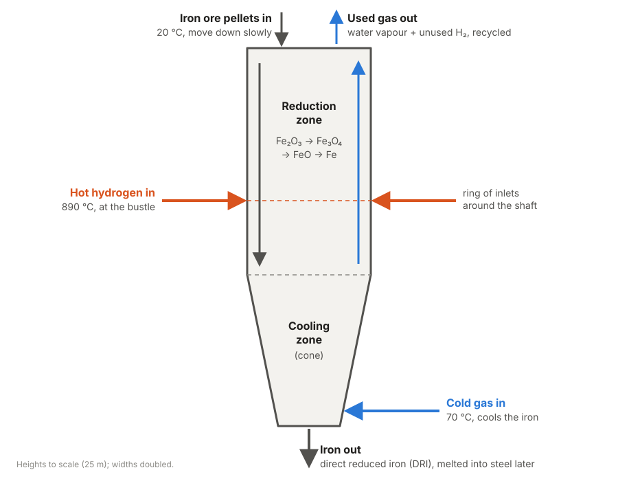
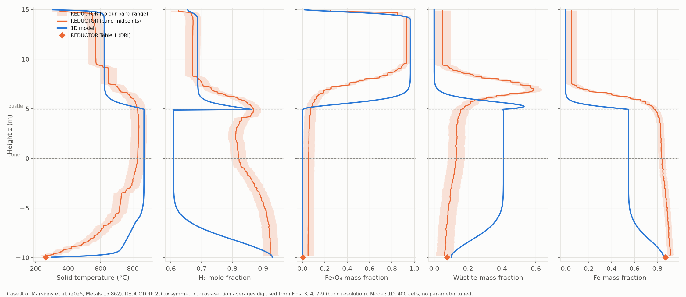
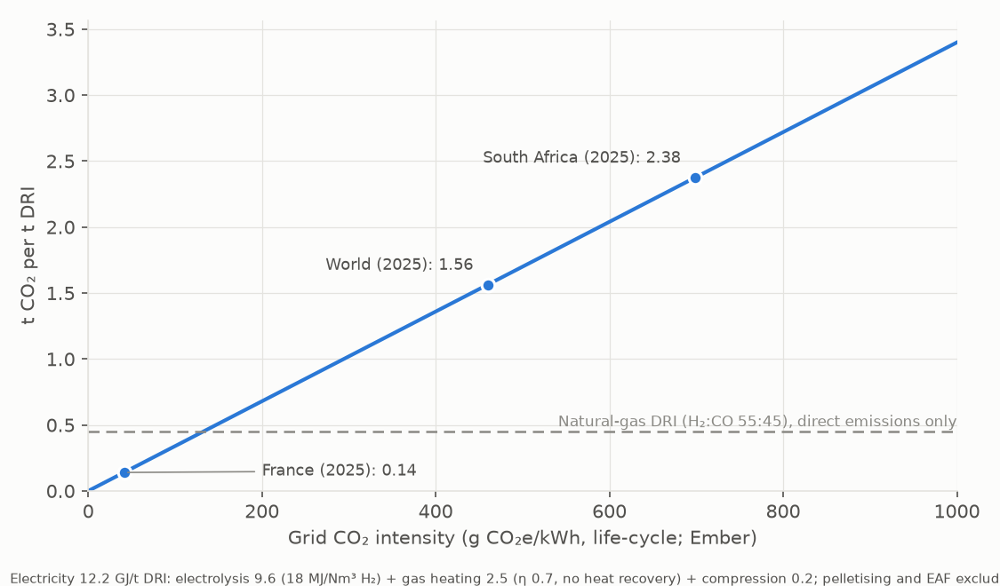

# Hydrogen Shaft Furnace Simulator

A physics-based simulator of a hydrogen direct-reduction shaft furnace, the technology at the centre of green steelmaking. Iron ore pellets move down the shaft while hot hydrogen flows up and removes the oxygen, producing direct reduced iron (DRI) with water as the main by-product instead of CO2.

The simulator predicts what happens inside the furnace, along its full height: temperatures, gas composition and how far the ore has been reduced at each point. Every physical parameter comes from a cited source (`data/SOURCES.md`), downloaded and checked by scripts.



**App:** runs locally with `streamlit run app/streamlit_app.py` (see *Run it* below). **New here?** Start with the [tutorial](docs/tutorial.md).

## Why this matters

- **Industry needs fast, validated models for scale-up.** The EU-funded MaxH2DR project (2022–2026), with Tata Steel Nederland as a partner, aims to develop validated digital twins of industrial hydrogen direct-reduction plants, because pilot trials alone cannot support scale-up. ([Łukasiewicz-GIT](https://git.lukasiewicz.gov.pl/en/?p=53997))
- **The modelling gaps are documented.** A December 2025 review identifies limited predictive accuracy, computational cost, uncertain reduction kinetics and scarce plant validation data as open problems, and names fast surrogate models and uncertainty quantification as future directions. ([Processes 14(1):138](https://www.mdpi.com/2227-9717/14/1/138))
- **It is happening in Southern Africa.** ArcelorMittal South Africa is studying green-hydrogen DRI at its Saldanha works using the Midrex process ([Mining Weekly](https://www.miningweekly.com/article/study-under-way-into-producing-green-direct-reduced-iron-at-mothballed-saldanha-works-2023-10-11)), and HyIron in Namibia is building a hydrogen DRI plant ([SteelOrbis](https://www.steelorbis.com/steel-news/latest-news/hyiron-produces-first-green-hydrogen-in-southern-africa-1385155.htm)).

This simulator is a screening model: one operating point takes 10–15 s (50 cells) to a few minutes (200 cells), so hundreds of scenarios run in an hour on a laptop, with quantified parameter uncertainty, before committing to CFD or pilot trials.

## What it does

- Reduction of hematite → magnetite → wüstite → iron in each pellet with a grainy-pellet model (law of additive reaction times), kinetic constants refitted to published thermogravimetry
- 1D steady-state counter-current moving bed (cylinder, cooling cone, bustle gas inlet) with coupled species and energy balances that close to round-off, solved by an alternating scheme with a fully coupled Newton solver as fallback
- Gas pressure field from the Ergun equation (optional local pressure in the kinetics)
- Metallisation, gas utilisation, H2 consumption (kg/t DRI), electricity demand and CO2 per tonne of DRI for any grid intensity, including South Africa's
- Comparison with the published 2D furnace model REDUCTOR on five operating cases, and with single-pellet experiments
- Uncertainty quantification (Monte Carlo, grouped Sobol indices) and sensitivity studies
- A Streamlit app with axial profiles, outlet values and an "Assumptions and limits" panel

## Results in two figures



**Against REDUCTOR (case A, no parameter tuned)** the outlet values agree within a few percent (converged metallisation 0.906 vs 0.933, top gas 360 vs 344 °C), but the 1D reduction front sits 1.5–2 m lower and the cooling zone behaves differently, so the agreement is partly compensation. On the other operating cases the model reproduces several *changes* REDUCTOR predicts: the top-gas temperature rise with N2 dilution (+41 vs +50 K) and with a hot burden (+456 vs +462 K), the gain in gas utilisation with N2 (+0.13 vs +0.14), and an optimum cooling-gas flow (625 vs ~600 mol/s). It overpredicts the loss of metallisation at higher cooling flows, where the 1D cooling front moves up into the cone.



**CO2 depends almost entirely on the electricity.** Electrolysis, gas heating and compression need about 12.2 GJ of electricity per tonne of DRI. On South Africa's 2025 grid (699 g CO2e/kWh, Ember) that is about 2.4 t CO2 per tonne of DRI, roughly five times the direct emissions of natural-gas DRI. Hydrogen DRI beats natural-gas DRI only below about 130 g/kWh, i.e. on dedicated renewables or a clean grid.

## Limitations (read before using the numbers)

- **1D plug flow, steady state**: no radial gradients, no H2-starved core, no wall effects, no start-up or upset dynamics. The comparison with a 2D model shows the 1D assumption matters.
- **Grid**: first-order upwind finite volumes converge slowly. A grid study to 3200 cells puts the converged case A at metallisation 0.906 and DRI 307 °C; 50-cell results (used for sampling and in the app) are ~0.04 too high in metallisation and ~40 K too cold at the DRI outlet. A second-order scheme is available but gains little, because the reacting solution has kinks.
- **Solver**: the alternating solver cycles where the cooling front sits inside the cone (625–750 mol/s cooling gas in the case B sweep) or the burden is fully reduced before the outlet; a fully coupled Newton solver now solves those points. Two full-metallisation endpoints of the sensitivity sweeps still do not converge and are reported as such, not as results.
- **Kinetics from one source** (seven TGA curves of one pellet type, 600–900 °C); no sticking, fines or carbon; no heat losses. The Ergun pressure drop matches REDUCTOR's upper shaft within about 10 % but overpredicts the cone 1–4× (1D flow through a converging cone).
- **CO2** covers electrolysis, gas heating (no heat recovery) and gas compression; not pelletising, the EAF or plant construction.

Details for every milestone: `docs/validation.md`.

## Status

All eight milestones of `PLAN.md` are done.

| Milestone | Main result | Code / notebook |
|---|---|---|
| 1 Thermodynamics | NIST Shomate data, checked against JANAF | `properties.py` |
| 2 Pellet kinetics | Grainy-pellet model, constants refitted to Marsigny et al. (2025) TGA data, checked on held-out curves | `pellet.py`, `transport.py` |
| 3 Isothermal shaft | Counter-current finite volumes, exact element balances, discrete shooting solver | `shaft.py`, `solver.py` |
| 4 Energy balance | Solid and gas energy equations, Wakao–Kaguei transfer, energy closure to round-off | `energy.py` |
| 5 Published model | Whole furnace vs REDUCTOR case A, digitised profiles | `05_reductor_comparison.ipynb` |
| 6 Uncertainty | 512 Monte Carlo + 1280 Sobol runs; tortuosity ~80 % of the variance (upper bound), kinetics ~20 % | `uq.py`, `06_uncertainty.ipynb` |
| 7 Analysis and app | REDUCTOR cases B–E, sensitivities, CO2 vs grid, Streamlit app, CI | `operating.py`, `emissions.py`, `scenario.py`, `07_analysis.ipynb`, `app/` |
| 8 Numerics and pressure | Coupled Newton solver (solves the cooling-front band), grid study to 3200 cells, optional second-order scheme, Ergun pressure, gas compression energy | `coupled.py`, `pressure.py`, `05_reductor_comparison.ipynb` |

## Run it

```
python -m venv .venv
.venv\Scripts\activate            # Windows; source .venv/bin/activate elsewhere
pip install -e ".[dev,uq,app]"
pytest && ruff check . && mypy
streamlit run app/streamlit_app.py
```

To rebuild the data from the primary sources: `python scripts/fetch_thermo_data.py`, `python scripts/fetch_references.py` (downloads the open-access papers into `references/`), `python scripts/extract_collision_integrals.py`, `python scripts/digitize_marsigny_fig6.py`, `python scripts/fit_kinetics.py`, `python scripts/extract_reductor_cases.py`, `python scripts/digitize_reductor_fig10.py`, `python scripts/extract_thesis_table20.py`, `python scripts/fetch_grid_intensity.py`.

## Data sources

All kinetic, thermodynamic, transport, operating and emission parameters come from cited literature and public datasets, listed in `data/SOURCES.md`.
