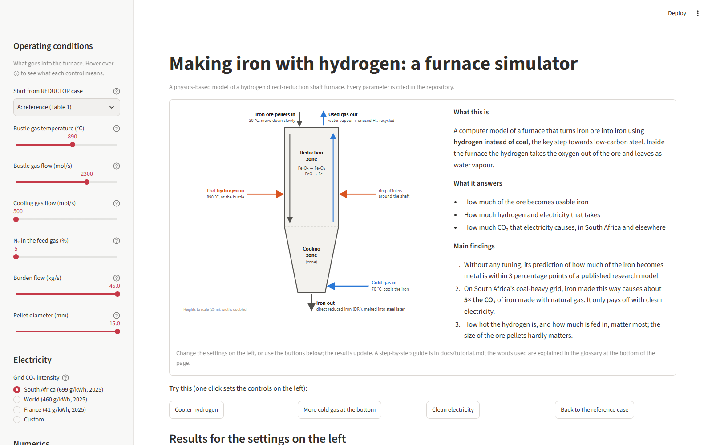
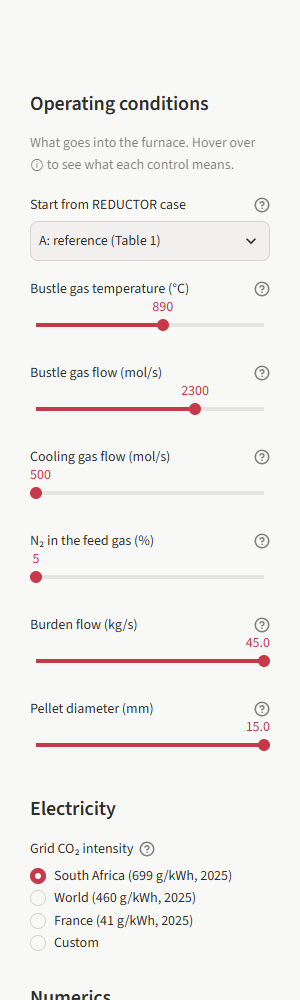
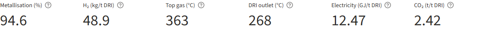
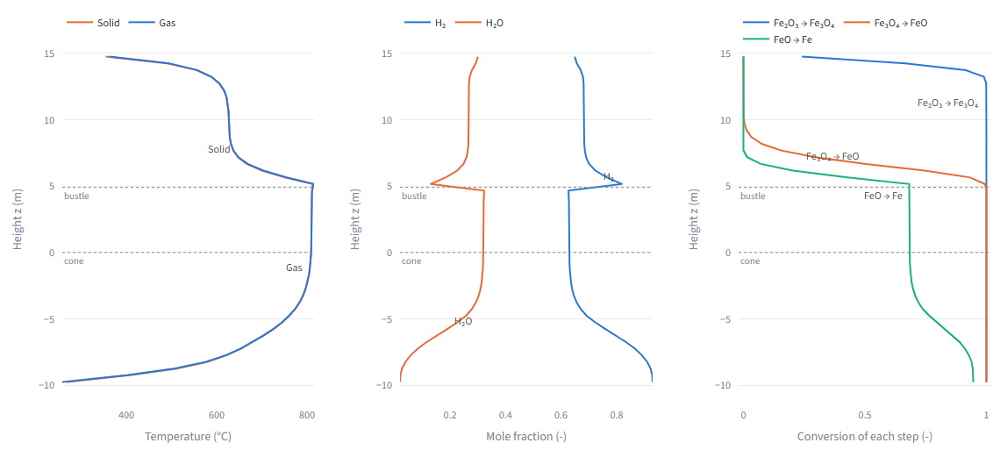
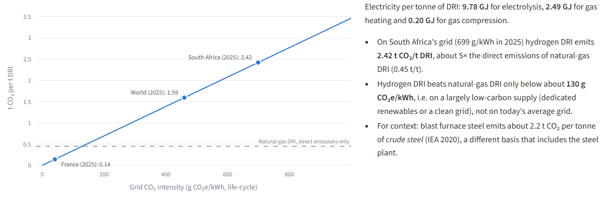
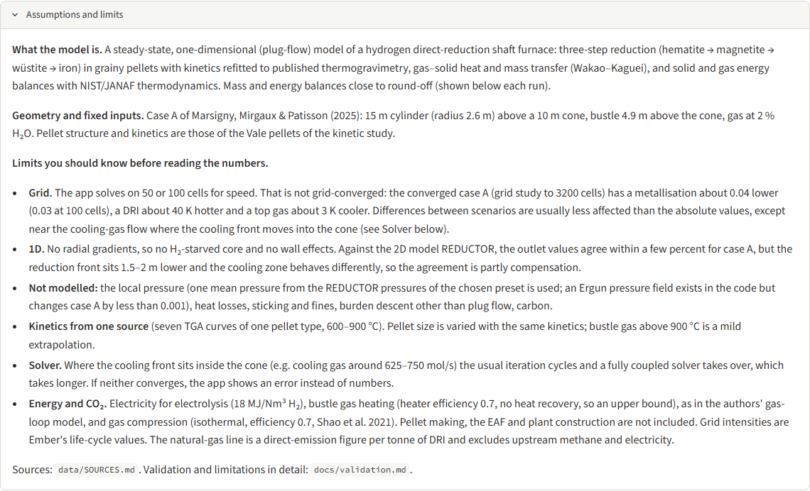

# Tutorial: using the hydrogen shaft furnace simulator

This guide takes you through the app in about 20 minutes: what each part of the screen shows,
five short exercises with the numbers you should see, and how to read the results without
over-reading them. No programming is needed for the app itself.

## 1. What the simulator is

A hydrogen shaft furnace turns iron ore pellets into direct reduced iron (DRI). Pellets enter at
the top and move down; hot hydrogen enters at the *bustle* (a ring of inlets 4.9 m above the
cone) and cooler hydrogen at the bottom. The gas rises, removes oxygen from the ore and leaves
at the top as a hydrogen–steam mixture.

The simulator solves the steady state of this furnace in one dimension (along the height):
temperatures of the solid and the gas, gas composition, and how far each reduction step
(hematite → magnetite → wüstite → iron) has progressed. The geometry and the reference
operating point are case A of Marsigny, Mirgaux & Patisson (2025), a 15 m cylinder above a
10 m cone producing about 117 t/h of DRI. Every physical parameter is cited in
`data/SOURCES.md`.

## 2. Starting the app

The app runs on your own computer (Windows PowerShell, from the project folder):

```powershell
python -m venv .venv
.venv\Scripts\activate
pip install -e ".[app]"
streamlit run app\streamlit_app.py
```

Your browser opens at http://localhost:8501. The first result takes about 15 seconds; results
you have already computed come back instantly.

## 3. A tour of the screen



From top to bottom: a panel that explains the furnace in plain words, with a diagram; a row
of **Try this** buttons; the headline numbers with a one-sentence summary; electricity and
CO₂; and the profiles inside the furnace. At the bottom: *Assumptions and limits*, a
**Glossary** of the words used, and the profile data as a table.

**Try this** buttons set all the controls for a guided scenario (a cooler hydrogen feed, more
cold gas at the bottom, clean electricity, or back to the reference case) and tell you what to
look for. The note disappears as soon as you change a control yourself.

### The sidebar: your inputs



| Control | What it changes | Range offered |
|---|---|---|
| Start from REDUCTOR case | Loads the operating conditions of a published case: A (reference), B (gas moved from the bustle to the cooling inlet), C (32 % nitrogen, 950 °C bustle gas), E (lower burden flow) | — |
| Bustle gas temperature | Temperature of the main hot gas | 815–950 °C |
| Bustle gas flow | Main hot gas flow | 2000–2430 mol/s |
| Cooling gas flow | Gas entering at the bottom at 70 °C | 500–800 mol/s |
| N₂ in the feed gas | Nitrogen share of both inlet gases (steam fixed at 2 %) | 5–32 % |
| Burden flow | Ore pellets fed at the top | 43–45 kg/s |
| Pellet diameter | Size of the pellets | 10–15 mm |
| Grid CO₂ intensity | Carbon intensity of the electricity for electrolysis and gas heating | South Africa, world, France (Ember 2025), or your own value |
| Grid cells | Resolution of the calculation: 50 (about 15 s) or 100 (about 40 s) | — |

The ranges are those the cited sources treat as realistic; the app does not let you leave
them. The app re-runs automatically when you change an input. Hover over the ⓘ next to a
control or a headline number to see what it means.

### The headline numbers



- **Metallisation:** share of the iron that leaves as metal. The reference paper calls 94 % "a usual average".
- **H₂:** hydrogen consumed per tonne of DRI.
- **Top gas:** temperature of the gas leaving at the top.
- **DRI outlet:** temperature of the product at the bottom.
- **Electricity:** electricity per tonne of DRI for electrolysis, gas heating and compression.
- **CO₂:** that electricity times the grid intensity you chose.

Below the tiles, a line reports the grid size, run time, gas utilisation, production rate and
how well the mass and energy balances close (round-off, about 1e-16). When the inputs are
exactly a published case, a blue box shows what the 2D model REDUCTOR reported for it.

### The profiles



Height runs from the cone outlet (−10 m) to the top (15 m); dotted lines mark the bustle and
the start of the cone.

- **Temperature:** solid and gas almost coincide, because heat transfer between them is fast.
  The hot zone sits just above and below the bustle.
- **Mole fraction:** hydrogen falls and steam rises as the gas moves up through the ore.
- **Conversion of each step:** hematite is reduced near the top, magnetite and wüstite around
  the bustle, and the rest of the wüstite in the cone.

A table of the same profiles is in **Profile data (table)** at the bottom of the page, next
to the **Glossary**.

### Electricity and CO₂



The line shows CO₂ per tonne of DRI for any grid intensity; the dots mark South Africa, the
world and France. The dashed line is the direct emission of a shaft furnace running on
reformed natural gas.

## 4. Five exercises

All numbers below are what the app shows on its default 50-cell grid.

**Exercise 1: the reference case.** Select case A. You should see metallisation 94.6 %,
48.9 kg H₂ per tonne, top gas 363 °C and DRI 268 °C. REDUCTOR reported 93.3 %, 344 °C and
261 °C. Close, but read section 5 before concluding the model is "validated".

**Exercise 2: gas temperature.** In case A, lower the bustle gas temperature from 890 to
840 °C. Metallisation falls to 80.0 %. Raise it to 920 °C and the iron is fully metallised
(100 %). Wüstite reduction is endothermic: it needs heat as well as hydrogen, and the bustle
gas is the main heat source.

**Exercise 3: nitrogen dilution (case C).** Select case C: 32 % nitrogen and 950 °C bustle gas.
Gas utilisation rises from 0.316 to 0.445 and the top gas is about 40 K hotter; REDUCTOR shows
the same trend (0.33 → 0.47, +50 K). Nitrogen carries extra heat into the furnace, so less
hydrogen is needed per unit of heat.

**Exercise 4: more cooling gas (case B).** Select case B (200 mol/s moved from the bustle to the
cooling inlet). The DRI now leaves at 74 °C and metallisation drops to 87.6 %. With this much
cold gas the whole lower cone cools down and the last wüstite stops reducing. REDUCTOR, a 2D
model, keeps a hot core and reports 93.7 %; here the 1D simplification matters. Lower the
cooling gas to 600 mol/s: metallisation recovers to 90.2 %.

**Exercise 5: the electricity grid.** Return to case A. On South Africa's grid (699 g CO₂e/kWh,
2025) the result is 2.38 t CO₂ per tonne of DRI, about five times the direct emissions of
natural-gas DRI (0.45 t). Choose France: 0.14 t. Choose *Custom* and find the break-even with
natural-gas DRI: about 130 g/kWh. Hydrogen DRI is only low-carbon on low-carbon electricity.

## 5. Reading the results responsibly

Open **Assumptions and limits** at the bottom of the page before using any number.



In short:

- The model is **one-dimensional and steady**: no radial differences across the furnace, no
  start-up or upsets. Against the 2D model REDUCTOR, the outlet values of case A agree within
  a few percent, but the reduction front sits lower in 1D, so part of the agreement is
  compensation.
- The app's **50-cell grid is coarse**: the grid-converged case A has a metallisation about
  4 percentage points lower and a DRI about 40 K hotter. Use the app to compare scenarios, and the
  scripts on fine grids for absolute numbers (`docs/validation.md`).
- Some conditions (for example cooling gas around 625–750 mol/s) need a slower, fully
  coupled solver, which the app calls automatically. A few fully reduced extremes still do
  not converge; the app then shows an error instead of numbers.
- **CO₂** covers electrolysis, gas heating and gas compression, not pelletising, the
  electric arc furnace or building the plant.

## 6. Going further

| To | Use |
|---|---|
| See how the model was checked, milestone by milestone | `docs/validation.md` |
| Check where every number comes from | `data/SOURCES.md` |
| Reproduce the analyses | `notebooks/05_reductor_comparison.ipynb`, `06_uncertainty.ipynb`, `07_analysis.ipynb` |
| Run a scenario from Python | `shaftsim.scenario.run_scenario` (see `notebooks/07_analysis.ipynb`, section 4) |
