# Validation

## Milestone 1 – Thermodynamics of the reduction steps

### What is computed

`shaftsim.properties` evaluates Cp, H, S and G per species from Shomate polynomials
(`data/species.yaml`), and for each reduction step the reaction enthalpy, the equilibrium
constant K(T) = exp(−ΔG°/RT) and the equilibrium gas composition H2O/H2 = K^(1/n).
Solids are pure phases (activity 1), gases ideal at 1 bar.

Reduction steps used by the model (wüstite as Fe0.947O, x = 0.947):

```
3 Fe2O3 + H2               = 2 Fe3O4 + H2O
Fe3O4 + (4 − 3/x) H2       = (3/x) FexO + (4 − 3/x) H2O
FexO + H2                  = x Fe + H2O
Fe3O4 + 4 H2               = 3 Fe + 4 H2O        (below the wüstite stability limit)
```

### Data provenance

All coefficients are downloaded and extracted by `scripts/fetch_thermo_data.py` (sources in
`data/SOURCES.md`). Two data decisions were needed:

1. **Wüstite is modelled as Fe0.947O, not FeO.** With the stoichiometric FeO data (NIST, and
   JANAF table Fe-018 agrees), wüstite would be stable down to **455 K**, which contradicts
   the well-known limit of about 570 °C. NIST has no Shomate data for Fe0.947O, so its
   coefficients are fitted to JANAF table Fe-001 (A–E by least squares on Cp over
   298.15–1600 K; F, G, H fixed by the 298.15 K values). With Fe0.947O the limit comes out at
   **893 K (620 °C)**. That is about 50 K above the commonly quoted ~570 °C; it is what the
   JANAF data give, and it is reported as is.
2. **Fe uses the four NIST α–δ ranges.** NIST also lists a single "γ phase" fit over
   298–1809 K; it describes metastable γ-iron and is not used.

### Comparison with JANAF (`tests/data/janaf_reference.csv`)

Maximum absolute deviation of the model from the JANAF tables, 298.15–1500 K (H2O 500–1500 K):

| Species | Rows | max ΔCp | max ΔS | max Δ(H−H298) |
|---|---|---|---|---|
| H2 | 14 | 0.011 % | 0.000 % | 1 J/mol |
| H2O | 11 | 0.040 % | 0.001 % | 2 J/mol |
| Fe, outside 700–1100 K | 10 | 0.49 % | 0.013 % | 16 J/mol |
| **Fe, 700–1100 K** | 4 | 0.27 % | **0.48 %** | **367 J/mol** |
| FeO (comparison only) | 14 | 0.13 % | 0.010 % | 8 J/mol |
| Fe3O4 | 14 | 0.050 % | 0.015 % | 8 J/mol |
| Fe2O3 | 14 | 0.11 % | 0.078 % | 26 J/mol |
| Fe0.947O (fit to the same table) | 14 | 0.013 % | 0.015 % | 6 J/mol |

Equilibrium constants, model (NIST Shomate) vs JANAF ΔfG, 500–1500 K:

| Step | max ΔG°, outside 700–1100 K | max ΔK | max ΔG°, 700–1100 K | max ΔK |
|---|---|---|---|---|
| Fe2O3 → Fe3O4 | 18 J/mol | 0.31 % | 32 J/mol | 0.43 % |
| Fe3O4 → Fe0.947O | 47 J/mol | 0.38 % | 30 J/mol | 0.33 % |
| Fe0.947O → Fe | 19 J/mol | 0.16 % | **325 J/mol** | **4.6 %** |
| Fe3O4 → Fe | 14 J/mol | 0.13 % | **1057 J/mol** | **15 %** |

Test tolerances (`tests/test_properties.py`): S and H−H298 within 0.1 % (H with a 50 J/mol
floor), Cp within 0.2 % (Shomate fit residuals reach 0.13 %), K within 1 %. The Fe window
below uses documented, wider tolerances.

### Known deviation: NIST Fe fit between 700 and 1100 K

NIST's Fe Shomate ranges 700–1042 K and 1042–1100 K (around the Curie point, 1042 K) do not
join continuously: H jumps by +141, −212 and −365 J/mol at 700, 1042 and 1100 K, where JANAF
has no latent heat. Inside this window the fit is off from JANAF by up to 0.37 kJ/mol in H and
0.48 % in S. Through G(Fe) this shifts the FeO→Fe equilibrium constant by up to 4.6 % (the
equilibrium H2 fraction by about 0.5 percentage points) and the Fe3O4→Fe constant by up to
15 %. The steps are visible in `figures/equilibrium_h2.png` at 427 °C and 769 °C.

This is a property of the published coefficients, not of the code: the extraction is exact,
and rounding of the printed coefficients explains less than 0.1 kJ/mol. The data were kept
as published rather than refitted; `test_fe_deviation_is_still_present` makes sure the note
is removed if the data ever change. For the shaft model this matters mostly in the upper
shaft (solids at 430–830 °C). Compared with the uncertainty of the reduction kinetics
(Milestone 6), it is small, but it is a candidate improvement (fit Fe to JANAF Fe-004
directly, as was done for wüstite).

### Results

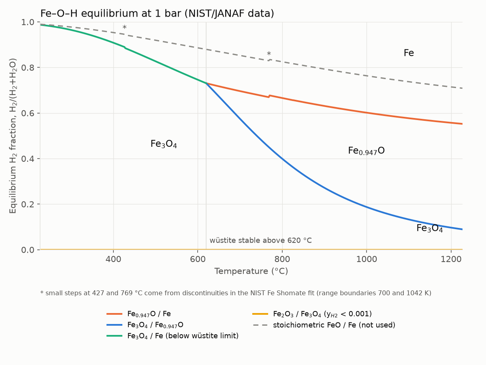

| T (°C) | y_H2 at Fe0.947O/Fe | y_H2 at Fe3O4/Fe0.947O | ΔH°, Fe0.947O→Fe | ΔH°, Fe3O4→Fe0.947O | ΔH°, Fe2O3→Fe3O4 |
|---|---|---|---|---|---|
| 800 | 0.666 | 0.399 | +16.4 kJ/mol | +50.7 kJ/mol | −10.3 kJ/mol |
| 900 | 0.631 | 0.272 | +15.9 kJ/mol | +50.0 kJ/mol | −11.2 kJ/mol |
| 950 | 0.616 | 0.225 | +15.5 kJ/mol | +49.8 kJ/mol | −11.7 kJ/mol |

At 900 °C the gas leaving the wüstite→iron zone can hold at most 37 % H2O, so no more than
about a third of the hydrogen can be used per pass in that step. This is why shaft furnaces
recycle a large excess of H2.

### Limitations

- Wüstite has a fixed composition (Fe0.947O). Real wüstite varies with temperature and
  oxygen potential (roughly Fe0.83O–Fe0.95O); its equilibria shift accordingly.
- Pure solid phases, no solid solutions; ideal gas at 1 bar.
- H2O data start at 500 K; property calls below that raise an error instead of
  extrapolating.
- The NIST Fe fit deviates from JANAF between 700 and 1100 K (above).
- The model's thermodynamic data are fits to one compilation (JANAF, 1998). JANAF
  agreement checks the fits and the code; it is not an independent experimental check.

## Milestone 2 – Single-pellet reduction kinetics

### Model

`shaftsim.pellet` implements the grainy pellet model with the law of additive reaction
times (GM-LART) of Marsigny, Letz, Mirgaux & Patisson (2025), *Metals* 15:1034, Appendix A,
which builds on Ranzani da Costa et al. (2013) and Wagner (2008). A pellet is an agglomerate
of dense hematite grains; Fe2O3 → Fe3O4 → Fe0.95O happen on the grains, the wüstite grains
break up into crystallites that are reduced to iron. For each step the characteristic times
of external mass transfer (Ranz–Marshall), pore diffusion (molecular + Knudsen, Bosanquet)
and interface reaction (first order in H2, driving force x_H2 − x_H2O/K) are added. Gas
properties come from `shaftsim.transport` (Chapman–Enskog with Svehla force constants and
Monchick–Mason collision integrals; experimental Marrero–Mason correlations for H2–He and
H2–N2). Equilibrium constants come from Milestone 1.

The thermobalance gas is a single state around the pellet: the mean of the inlet and the
outlet composition of a furnace balance in which the H2 consumed equals the oxygen removed
(the paper uses a 1-D discretisation of the furnace). In the base case (1.8 Nlpm, 55 % H2)
the H2 fraction seen by the pellet falls from 0.55 to 0.49 at the peak rate; ignoring this
depletion shortens t50 at 900 °C by about 20 %.

### Data provenance

- Every number in `data/kinetics.yaml` that comes from a text-layer PDF carries a verbatim
  quote, and `tests/test_provenance.py` checks the quote and the number against the source
  text (30 entries).
- Values from scanned pages (Svehla 1962 force constants; Marrero & Mason 1972 correlations;
  Table A1 equations; Ranz–Marshall exponents) were read from the page images. The OCR text of
  Svehla's table misaligns the ε/k column, which is why the image was used. They are
  cross-checked numerically where possible (below).
- The experimental curves of Figs. 6 and 9 are raster images. They were digitised
  automatically by colour (`scripts/digitize_marsigny_fig6.py`). The axis calibration agrees
  with the tick marks within 0.10 min (Fig. 6) and 0.02 min (Fig. 9). The digitised 900 °C
  curve gives t50 = 5.65 min and t90 = 16.31 min, within one standard deviation of the
  repeatability values the paper gives in its text (6.03 ± 0.55 and 16.86 ± 1.19 min, 5 runs).
  Only the solid (experimental) lines are exported: the dotted model lines could not be
  extracted reliably where curves are close.

### Departures from the published model

| Item | Published model | Here | Why |
|---|---|---|---|
| Solid-state diffusion through dense iron, iron sintering | included (Wagner 2008, Table A1) | omitted | constants (D_sol, O concentrations, sintering time) are not published |
| Grain/crystallite structure, pore sizes | not stated | Wagner (2008): crystallites 2 µm, pores 10 µm / 0.1 µm, wüstite grain porosity 0.53 | group's earlier model; assumed unchanged |
| Layer porosities | not stated | constant-volume molar balance (Marsigny thesis, eq. 51), from true densities (Wagner 2008) | — |
| Effective diffusivity | printed as (ε/τ)(1/D_mix + 1/D_K) | (ε/τ)/(1/D_mix + 1/D_K) | the printed form has wrong units; Bosanquet is the standard form |
| Chemical time of step 2 | factor 2 | factor 2 kept | 2·b = 2.375 would match the other entries; kept because the constants were fitted with the printed form |
| Furnace gas | 1-D finite volumes | one gas state, mean of inlet and outlet | simpler; same mass balance |
| Wüstite | Fe0.95O | Fe0.95O in the stoichiometry, Fe0.947O (JANAF) in K | thermodynamic data of Milestone 1 |

### Result 1: the published kinetic constants do not transfer

With the published triplets (Table 2) and this structure the model is close at 850–900 °C
but much too slow at low temperature (RMSE in X: 0.28 at 600 °C, 0.20 at 650 °C, 0.12 at
700 °C, 0.048 at 900 °C). The published activation energy of the wüstite step (116 kJ/mol)
implies a factor ~50 between 600 and 900 °C for a chemically controlled step, while the
measured t90 changes by a factor 5.2. In the paper the wüstite step at 900 °C is under mixed
control, so the published constants rely on diffusion resistances (solid-state diffusion,
structure) whose parameters are not published. **The published triplets are therefore only
meaningful together with the authors' unpublished parameters.**
(`test_published_triplets_known_deviation` keeps this statement true.)

### Result 2: re-fitted constants

Following the paper's own procedure (Sec. 3.1: fit the triplets to the TG96 curves at
600–900 °C, X ≤ 0.99), the six constants were re-fitted with this model
(`scripts/fit_kinetics.py` → `data/kinetics_refit.yaml`; parameters ln k(750 °C) and Ea per
step; nothing else adjusted).

| Step | k0 (m/s) | Ea (kJ/mol) ± 1 s.e. | published Ea (kJ/mol) |
|---|---|---|---|
| Fe2O3 → Fe3O4 | 0.00257 | 40.6 ± 5.8 | 30.6 |
| Fe3O4 → Fe0.95O | 0.00831 | 51.2 ± 4.0 | 80.7 |
| Fe0.95O → Fe | 0.00922 | 65.8 ± 0.8 | 115.9 |

The fitted Ea of the wüstite step lies inside the 57–135 kJ/mol range of the literature
values compiled in the paper (Fig. 5). The standard errors come from the Jacobian of the fit
and ignore digitisation and experimental error, so they are lower bounds; the correlations
between steps (up to −0.78, `data/kinetics_refit.yaml`) matter for Milestone 6.

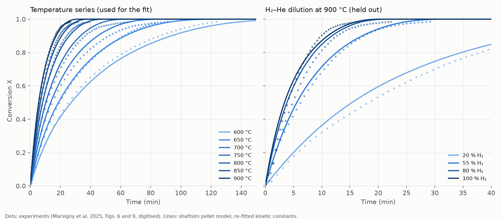

| Data | Used in fit? | Result |
|---|---|---|
| Fig. 6 temperature series, 600–900 °C | yes | RMSE in X per temperature: 600 °C 0.019, 650 °C 0.008, 700 °C 0.027, 750 °C 0.018, 800 °C 0.013, 850 °C 0.014, 900 °C 0.006 |
| Fig. 6, leave-one-temperature-out (each temperature predicted by a fit to the other six) | no | predictive RMSE: 600 °C 0.044, 650 °C 0.011, 700 °C 0.032, 750 °C 0.021, 800 °C 0.015, 850 °C 0.019, 900 °C 0.008 (600 °C is an extrapolation) |
| Repeatability, 900 °C, 5 runs (text, Sec. 2.2) | no | t50 = 5.58 min (exp. 6.03 ± 0.55), t90 = 17.17 min (exp. 16.86 ± 1.19): both within 1 s.d. |
| Fig. 9 H2–He dilution, 900 °C | no | RMSE in X: 20 % H2 0.045, 55 % 0.020, 80 % 0.050, 100 % 0.042; model t50 short by 16 %, 10 %, 20 %, 14 % |

### Limitations

- The kinetic constants are fitted to one pellet type (Vale DR-grade, 12.8 mm, ε = 0.295)
  in one thermobalance. Transfer to other pellets is untested.
- The model is consistently somewhat too fast in the H2–He dilution series (t50 10–20 % short
  at every H2 fraction). The run-to-run scatter of the experiments is of order 10 % in time
  (the nominally identical base-case runs in Figs. 6 and 9 differ by 10 % in t50).
- No nucleation effects, no slowdown at 700–750 °C above X = 0.6 (also missing from the
  published model), no sintering, no solid-state diffusion, no swelling or cracking.
- Chapman–Enskog with the Svehla force constants under-predicts the measured binary
  diffusivities by 5–14 % at 1000–1500 K (H2–He, H2–N2). The experimental correlation is used
  for those pairs; H2–H2O has no correlation in Marrero & Mason, so its Chapman–Enskog value
  is probably about 10 % low at furnace temperatures. Diffusion is a minor resistance in the
  base case, so this has a small effect.
- Pore diffusivities are evaluated at the bulk gas composition, and k_g at the inlet
  composition.

## Milestone 3 – Isothermal 1D shaft

### Model

`shaftsim.shaft` is a steady 1D counter-current moving bed:
- Plug flow of both phases, no axial dispersion, uniform temperature and pressure, constant bed porosity.
- Pellets (the Milestone 2 model) enter at the top; H2/H2O/N2 enters at the bottom.
- External mass transfer in the bed: Wakao–Kaguei, Sh = 2 + 1.1 Sc^(1/3) Re^0.6 (as given by Wagner 2008, Sec. III.5.3).

**Discretisation.** Finite volumes, first-order upwind for each phase: the solid comes from the cell above and the gas from the cell below, and each cell is evaluated at its outlet state. The gas source in a cell is written with the same discrete change of solid conversion that removes the oxygen. As a result, **the Fe, O and H balances close to round-off (≤ 1e-15) on any grid**, not only to within the discretisation error.

**Reference case.** Case A of Marsigny, Mirgaux & Patisson (2025, *Metals* 15:862):
- the reduction zone above the bustle (15 − 4.9 = 10.1 m), radius 2.6 m;
- 45 kg/s of 15 mm pellets, bed porosity 0.5;
- 2800 mol/s of 93/2/5 % H2/H2O/N2.

"2.6 m wide" in the paper is the radius: the radial axis of its Fig. 2 runs 0–2.6 m, and 45 kg/s over π·2.6² m² gives the 2.1 kg m⁻² s⁻¹ axial solid flux shown there (a 2.6 m diameter would give 8.5).

Assumptions for Milestone 3:
- all gas (bustle + cooling) enters at the bottom of the zone;
- isothermal;
- constant pressure (mean of the bustle and top pressures);
- pellet structure as the Vale pellets of Milestone 2.

### Solver

The two inlets sit at opposite ends, which is the hard part. Three methods are tried in order:

1. **Discrete shooting on the top-gas composition (primary).** Given the H2 fraction of the top-cell gas, the discrete equations can be marched from the top, cell by cell; the gas arriving at the bottom must match the inlet. That bottom value increases monotonically with the top value, so bisection always converges. Each step solves the discrete cell equations exactly, so there is no error growth (residual ~1e-11).
2. **Symmetric Gauss–Seidel sweeps with coupled cells.** Each cell is solved for its solid conversions and outlet gas together, given its neighbours.
   - Solving each phase for a frozen other phase was tried first and fails: with fast kinetics a cell then consumes more H2 than it receives, and the iteration oscillates.
   - Used when shooting fails, starting from a half-resolution solution (grid continuation) or from a neighbouring case (continuation in a parameter).
3. **Pseudo-transient continuation** (implicit Euler in pseudo-time turning into Newton, with a sparse banded finite-difference Jacobian). Last resort only: the rate law is not smooth (the min() of the oxide availability constraint, and the unbounded derivative of (1−X)^(2/3) at X → 1), so Newton stalls near 1e-7.

The solver always reports which method converged and whether it did. An unconverged result is never presented as a solution. Typical cost: 0.2–1.9 s for 100–400 cells.

**Comparison with `scipy.integrate.solve_bvp`** (`scripts/compare_bvp.py`, same equations in continuous form):

| Case | Finite volumes, 200 / 400 / 800 cells → Richardson | solve_bvp, naive guess | solve_bvp, FV solution as guess |
|---|---|---|---|
| 700 °C, 3 m | 0.93790 / 0.93970 / 0.94061 → 0.94151 | converged, 0.1 s, metallisation 0.94151 | converged, 0.5 s, metallisation 0.94151 |
| 890 °C, 10.1 m | 1.00000 / 1.00000 / 1.00000 → 1.00000 | converged, 0.5 s, metallisation 1.00000 | converged, 0.9 s, metallisation 1.00000 |
| 800 °C, gas-limited 1157 mol/s | 0.60021 / 0.60021 / 0.60021 → 0.60021 | failed (The maximum number of mesh nodes is exceeded.) | converged, 0.5 s, metallisation 0.60021 |
| 800 °C, gas-limited 1639 mol/s | 0.85025 / 0.85025 / 0.85025 → 0.85025 | failed (The maximum number of mesh nodes is exceeded.) | converged, 0.3 s, metallisation 0.85025 |
| 800 °C, 1157 mol/s, rates x100 | 0.60021 / 0.60021 / 0.60021 → 0.60021 | failed (The maximum number of mesh nodes is exceeded.) | failed (The maximum number of mesh nodes is exceeded.) |

Conclusion:
- On smooth cases `solve_bvp` is faster and, being higher order, more accurate. The first-order finite volumes need 800 cells to get within 0.001 of the extrapolated value.
- But `solve_bvp` fails from a naive starting point as soon as a sharp front forms (gas-limited pinch), and fails altogether with fast kinetics. The finite-volume solver converged in every case tried.
- The finite-volume solver is therefore the production method: it is robust, closes the balances exactly, and extends to the energy balance and to 2D.
- `solve_bvp` is kept as an independent, higher-order check on smooth cases; there the two agree to 5 digits after Richardson extrapolation.

### Tests (`tests/test_shaft.py`)

| PLAN requirement | Result |
|---|---|
| Element balances Fe, O, H close to 1e-6 | ≤ 1e-12 asserted (round-off, by construction), including gas-limited cases |
| Infinitely fast kinetics reproduce the equilibrium limit | Below the minimum gas flow, metallisation equals the counter-current pinch value from the Milestone 1 equilibrium constants (gas leaving the iron zone at the Fe/FeₓO equilibrium) to 1e-5, at 0.6 and 0.85 of the minimum flow; unchanged with rates ×10, ×100, ×1000 |
| Zero kinetics give no reduction | X = 0 everywhere, gas unchanged |
| Results converge as the grid is refined | 700 °C, 3 m zone: metallisation 0.9271 / 0.9343 / 0.9379 / 0.9397 on 50/100/200/400 cells; differences halve (first order); Richardson extrapolate 0.9415 |

Also tested:
- the top gas follows from stoichiometry at full metallisation;
- profiles are monotone;
- both solution methods give the same discrete solution;
- the banded Jacobian equals the dense one;
- below the wüstite stability limit (893 K with these data) the model still converges and reduces less than at higher temperature. The three steps are kept, with wüstite treated as metastable, because the three-step pellet model has no Fe3O4 → Fe path (the paper limits it to T > 570 °C). An earlier version rejected these temperatures; Milestone 4 needs them (the burden enters cold), see below.

### Isothermal case A

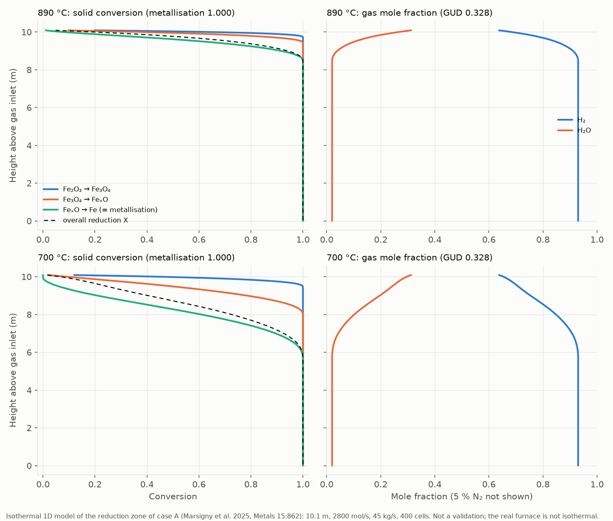

At 890 °C (the bustle gas temperature) the burden is fully metallised within the top ~1.5 m, and the top gas has GUD = 0.328. At 700 °C it is fully metallised within ~4 m.

With full metallisation the top-gas composition follows from the mass balance alone. That is why GUD equals the 0.33 that REDUCTOR reports for case A, where metallisation is 93.3 %.

**This is not a validation.** The real furnace is far from isothermal (the solid enters at 20 °C and the top gas leaves at 344 °C), so the isothermal model at bustle temperature overestimates the reduction rate in the upper shaft. The comparison with REDUCTOR is Milestone 5, after the energy balance.

### Limitations

- Isothermal, constant pressure, 1D plug flow (no radial gradients; REDUCTOR shows a poorly reduced centre), no axial dispersion, constant bed porosity, no pellet shrinkage.
- All gas enters at the bottom of the zone. In the real furnace the cooling gas joins from below the bustle, and the region below the bustle also reduces.
- Pellet properties other than diameter and hematite content are not those of the case A pellets (not published); the Vale pellets of Milestone 2 are used.
- First-order upwind: about 0.002 error in metallisation at 400 cells in a kinetically limited case.
- Below the wüstite stability limit of the thermodynamic data (893 K) wüstite is treated as metastable (the three steps keep their own equilibrium constants); the direct Fe3O4 → Fe path that is thermodynamically preferred there is not modelled. The published kinetics were measured above 570 °C only.

## Milestone 4 – Energy balance and heat transfer

### Model

`shaftsim.energy` adds one energy equation per phase to the Milestone 3 model, on the same finite-volume grid and with the same upwinding. Per cell i:

    solid:  Hs_i − Hs_{i−1} = UA_i (Tg_i − Ts_i) + n_i [H_H2(Tg_i) − H_H2O(Ts_i)]
    gas:    Hg_i − Hg_{i+1} = −(the same right-hand side)

- Hs and Hg are **absolute** (formation-referenced) enthalpy flows from the Milestone 1 data, so reaction heats appear without a separate ΔH term. n_i is the oxygen removed in the cell. The H2 consumed leaves the gas at the gas temperature and the H2O formed leaves the pellet at the solid temperature, so the reaction heat is absorbed in the solid, as in REDUCTOR (Marsigny et al. 2025b, eq. 6).
- The burden includes the gangue (CaO, SiO2, MgO, Al2O3: 3.35 wt-%, NIST data). Wüstite uses the JANAF-fitted Fe0.947O; the 0.003 mol Fe difference from the kinetic Fe0.95O is booked as Fe, so the elements stay consistent.
- Gas–solid heat transfer uses Wakao–Kaguei, Nu = 2 + 1.1 Pr^(1/3) Re^0.6, with a = 6(1 − ε)/d_p. The gas conductivity is the modified Eucken form of Svehla (1962, eq. B3, f_int = 1.32) mixed by Wilke's rule.
- Kinetic coefficients are evaluated at the solid temperature, and external mass transfer at the gas temperature. Both are tabulated on a 1 K grid with log-linear interpolation (≤ 2e-5 relative error, tested).
- The three reduction steps run at all temperatures. Below the wüstite stability limit of the data (893 K) wüstite is metastable. An earlier version switched steps 2–3 off below 893 K. That switch is discontinuous in T, and because wüstite reduction is endothermic, cells oscillated across it and the coupled iteration never converged.

**Enthalpy across NIST range boundaries.** NIST's piecewise Shomate H jumps where two ranges meet. Notable jumps are Fe2O3 +0.66 kJ/mol at 950 K, SiO2 +0.73 kJ/mol at 847 K, and Fe +0.14/−0.21/−0.36 kJ/mol at 700/1042/1100 K.
- For Fe2O3 the jump is the λ-transition enthalpy that the Cp polynomial leaves out: NIST H agrees with JANAF within 0.04 kJ/mol on both sides.
- For Fe it is the fit defect described under Milestone 1.

A jump, and especially a negative one, can leave a cell energy balance without a root. With reactions off and h × 3e-3, the energy Newton cycled between 947 and 951 K in one cell. Within ±10 K of each boundary, H is therefore interpolated linearly between the NIST values at the window edges:
- H is continuous and strictly increasing; the smallest effective Cp is 28 J/(mol K), for Fe at 1100 K;
- outside the windows H is exactly NIST;
- the energy model uses this H and its derivative consistently, so closure is unaffected.

This is a numerical choice, not new data (tested in `test_enthalpy_bridged_across_shomate_ranges`).

Outside the data ranges (H2O below 500 K, solids below 298 K), H is extended linearly with Cp at the range limit.

### Solver

The problem is solved by an outer fixed point:
1. species at frozen temperatures, with the Milestone 3 solver;
2. energy at frozen species, by Newton's method with the analytic block-tridiagonal Jacobian (tested against finite differences).

The outer map is accelerated with Anderson mixing (memory 5, damping 0.5).

Plain damped iteration converges, but slowly. The cold front, where endothermic wüstite reduction stalls, moves about one cell every few iterations. Grids above 25 cells therefore start from the interpolated solution on half the cells, recursively. Converged means a temperature change below 1e-6 K, with both sub-problems converged at the final temperatures. Non-converged results are flagged, never reported as solutions.

### Tests (`tests/test_energy.py`, 12 tests, ~45 s)

| PLAN requirement | Result |
|---|---|
| Energy balance closes to 1e-6 of the inlet enthalpy flow | < 1e-10 asserted (round-off, ~1e-16 observed), relative to both the absolute and the sensible inlet enthalpy, with and without reactions |
| Reactions off: counter-current exchange behaviour | Gas hotter than solid everywhere, both increasing downward, gap narrowing toward the bottom. The burden (the smaller heat-capacity flow) leaves at the gas inlet temperature (pinch). |

Also tested:
- **No heat transfer.** Both phases keep their inlet temperatures.
- **h × 1000.** Burden outlet equals the gas inlet temperature to 1e-3 K, and the top-gas temperature equals the value from the overall energy balance alone.
- **Independent reference, reactions off, h × 3e-3.** Finite volumes (50/100 cells, Richardson extrapolation) agree with a shooting solution (RK45, rtol 1e-10, brentq on the top-gas temperature):
  - top gas 830.21 K vs 830.19 K; burden outlet 997.18 K vs 997.21 K;
  - the shooting solution agrees with `scipy.integrate.solve_bvp` to 1e-6 K;
  - the comparison uses reduced h because at the real h the bed pinches, which would make it trivial.
- **Element balances.** Still exact (≤ 1e-12) in the non-isothermal solution.
- **Endothermic reduction.** The top gas leaves more than 50 K colder with reactions than without.
- **Analytic energy Jacobian.** Matches finite differences.
- **H2 transport properties.** Viscosity and modified-Eucken conductivity match Svehla (1962) Table III at 800/1000/1200 K within 0.8 % (`tests/data/svehla1962_table3_H2.csv`). This checks the implementation, since Svehla uses the same theory and constants; it does not validate the property model.

### Case A reduction zone (non-isothermal)

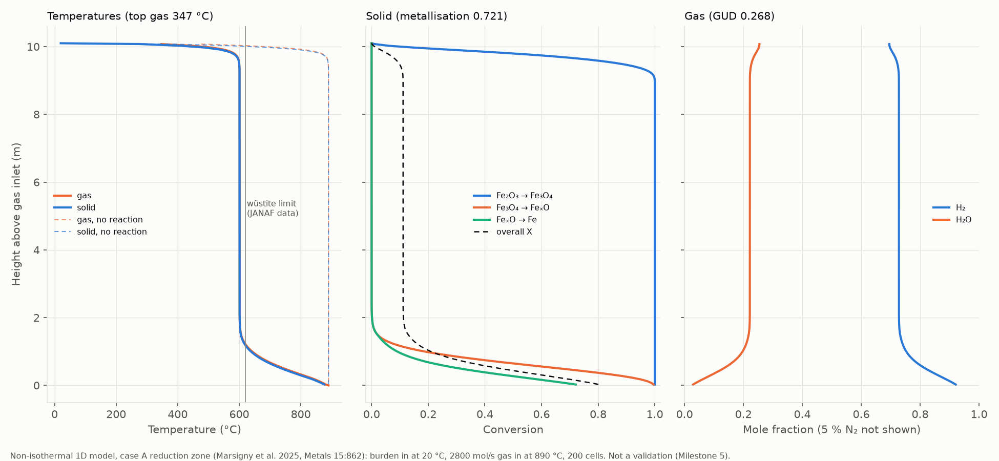

Burden enters at 20 °C. 2800 mol/s of 93/2/5 % H2/H2O/N2 enter at 890 °C at the bottom of the 10.1 m zone.

Grid study (`solve_thermal`; energy closure ≤ 3e-16 on every grid):

| Cells | Outer iterations | Time | Metallisation | Top gas (°C) | Burden out (°C) | GUD |
|---|---|---|---|---|---|---|
| 25 | 42 | 9 s | 0.8099 | 352.8 | 837.0 | 0.287 |
| 50 | 21 | 15 s | 0.7691 | 350.0 | 855.5 | 0.278 |
| 100 | 23 | 23 s | 0.7396 | 348.1 | 868.4 | 0.272 |
| 200 | 36 | 71 s | 0.7209 | 346.8 | 876.4 | 0.268 |
| 400 | 29 | 99 s | 0.7103 | 346.1 | 880.8 | 0.266 |

- Successive differences shrink by factors of 1.4, 1.6 and 1.8, approaching the first-order factor of 2 only slowly, because the cold front is sharp.
- Extrapolating with the last observed ratio gives a metallisation of about 0.696–0.70 and a top gas of about 345 °C.
- The discretisation error at 400 cells is therefore about 0.01–0.015 in metallisation, much larger than in the isothermal case. A higher-order or adaptive grid is a candidate improvement.

What the profiles show:
- The cold burden is heated within the top ~0.5 m, and hematite is reduced to magnetite there.
- The gas leaving the bottom zone has been cooled to about 600 °C by the endothermic wüstite reduction (and by heating the burden). Over about 8 m the bed is then a **thermal plateau at about 600 °C**, with gas and solid at nearly the same temperature, magnetite almost unreduced (overall X ≈ 0.11) and the gas composition frozen.
- All further reduction happens in the bottom ~1.5 m, where the gas is hotter.
- Without reactions the burden reaches 890 °C within the top 0.5 m and the top gas leaves at 476 °C.

**This is not a validation** (that is Milestone 5). For orientation only:
- REDUCTOR reports a top gas of 344 °C for case A. The model's ~345 °C is largely set by the overall energy balance, so agreement there says little.
- REDUCTOR's metallisation is 93.3 %, and this model's ~0.70 is far lower. Likely contributors, not yet tested, are the limitations below: no reduction below the bustle, all gas entering at one point, the pellet parameters and kinetics fitted at ≥ 600 °C, and the treatment below 893 K. REDUCTOR also shows a low-temperature region (500–650 °C) in the upper shaft, but with different extent and conversion.
- *Update (Milestone 5):* with the whole furnace (cooling cone, bustle side inlet) the model reaches about 0.90–0.92, so most of the gap came from the region below the bustle that this reduction-zone model leaves out.

### Limitations

- Adiabatic wall, no radiation, no axial conduction or dispersion, constant pressure (no Ergun pressure drop), 1D plug flow.
- Heat transfer by Wakao–Kaguei without intraparticle conduction (the pellet is isothermal: no Biot correction).
- All gas (bustle + cooling) enters at the bottom of the zone at 890 °C. The region below the bustle is not modelled.
- First-order upwind: about 0.01–0.015 error in metallisation at 400 cells for case A (see grid study).
- Below 893 K wüstite is treated as metastable; the kinetics were fitted to TGA data at 600–900 °C and are extrapolated to the cooler upper shaft.
- Enthalpy bridged over ±10 K at NIST range boundaries (see above), and extended linearly below the data ranges (H2O below 500 K, solids below 298 K). The equilibrium constants below 500 K use the 500 K value (only relevant in the top ~0.5 m, where the burden is still cold).
- The NIST Fe fit deviates from JANAF by up to 0.37 kJ/mol between 700 and 1100 K (Milestone 1).
- Run time: 10–100 s per case, depending on the grid. Too slow for large Monte Carlo studies without a coarser grid or a faster outer iteration.

## Milestone 5 – Comparison with a published furnace model (REDUCTOR, case A)

### Reference and data

**Reference model.** Case A of Marsigny, Mirgaux & Patisson (2025, *Metals* 15:862): REDUCTOR, a 2D axisymmetric steady-state model of a 100 % H2 Midrex-type shaft furnace (15 m cylinder + 10 m cone).

Why this reference:
- it publishes its inputs and its outputs (Table 1);
- it publishes full 2D maps (Figs. 3–9);
- it uses the same kinetic model family as Milestone 2, so the comparison isolates the furnace model.

The flip side is that it is **not an independent check of the kinetics**.

| File | Content | Made by |
|---|---|---|
| `data/furnace.yaml` | Inputs: geometry (cone 10 m, outlet radius 1.31 m), gas inlets (bustle 2300 mol/s at 890 °C at z = 4.9 m; cooling gas 500 mol/s at 70 °C at the bottom), burden. Quotes checked against the PDF text | by hand, with quotes |
| `tests/data/reference_model_marsigny2025b_caseA.csv` | Table 1 outputs (top gas, DRI, metallisation, GUD) | `scripts/extract_reductor_table1.py` |
| `tests/data/reference_model_marsigny2025b_caseA_profiles.csv` | Cross-section averages of the case A maps (Figs. 3, 4, 6–9) | `scripts/digitize_reductor_maps.py` |

**Table 1** is scrambled in the text layer, so its values were read from the page image. The script checks every value against the text layer and checks the table's internal consistency:
- the DRI composition adds up to 100 %;
- it gives the reported metallisation (93.2 vs 93.3 %);
- the top-gas composition gives the reported GUD.

**The maps** are filled-contour plots with discrete colour bands. The digitiser does the following:
- calibrates z from the axis ticks, with equal aspect (the coloured region's edge matches the 2.6 m radius and the cone geometry within 0.1 m);
- assigns each pixel to the nearest colour-bar band (86–100 % of the pixels in every row);
- averages over the cross-section weighted by r.

A value is therefore known only to within its band: ±50 K, ±0.025 in H2 fraction, ±0.05 in mass fraction. The comparison uses the band range, not the midpoint. Check figure: `figures/digitization_check_reductor.png`.

### Model extension (whole furnace)

`shaftsim.shaft` now accepts several **segments** (cylinders or truncated cones) and **side gas inlets** at segment boundaries, collected in a per-cell `Grid`. The grid stores dz, the exact mean area, the residence time, the gas flow leaving each cell upward, and the side injection.

- **Gas balance.** The gas equation uses the mixed inflow (F_{i+1} f_{i+1} + S_i f_s)/F_i.
- **Energy.** The energy equation receives the side-gas enthalpy. Heat and mass transfer scale with the local gas mass flux. Wakao–Kaguei is a + b Re^m X^n, so the two parts are tabulated separately and the b-part is multiplied by (G_i/G_ref)^m, which is exact.
- **Solver.** The shooting monotonicity argument is unchanged. Grid continuation now coarsens per-cell coefficients correctly; this was a bug the reduction-zone cases never reached.
- **Case A whole furnace** (`energy.load_furnace_case`):
  - 10.1 m above the bustle, 4.9 m below it, then the 10 m cone;
  - one pressure for the whole furnace: the length-weighted mean of the piecewise-linear profile through the Table 1 pressures, 174.6 kPa. The bustle and cooling pressures are REDUCTOR outputs, used here as boundary values; the local pressure differs from the mean by at most 14 %, at the top.

Tests (`tests/test_furnace.py`, 14 tests):

| Check | Result |
|---|---|
| Side inlet at the bottom face + reduced bottom flow = single bottom inlet | identical discrete solution (≤ 1e-6 K, 1e-8 in X) |
| Two cylinder segments = one cylinder | identical grid |
| Bed volume and residence time with the cone | exact (frustum formula, 1e-12) |
| Whole furnace: energy and element balances | ≤ 1e-10 and ≤ 1e-12 (round-off) |
| Isothermal side-inlet case | element balances exact; H2 consumed = O removed |
| Model outputs | DRI mass fractions add to 100 %, metallisation consistent |
| Reference files | Table 1 consistency; digitised edge radius vs geometry; band bounds ordered |
| Regression | 50-cell outputs pinned to the grid-study row below |

The Milestone 3 and 4 tests pass unchanged: without segments and side inlets the grid is the old uniform one.

### Grid study (whole furnace)

| Cells | Time | Metallisation | Top gas (°C) | DRI (°C) | GUD |
|---|---|---|---|---|---|
| 50 | 24 s | 0.9456 | 363.0 | 268.3 | 0.3165 |
| 100 | 55 s | 0.9367 | 361.9 | 278.8 | 0.3146 |
| 200 | 164 s | 0.9237 | 360.9 | 291.0 | 0.3118 |
| 400 | 932 s | 0.9157 | 360.3 | 298.3 | 0.3101 |
| 800 | 59 s ¹ | 0.9112 | 360.0 | 302.5 | 0.3091 |
| 1600 | 121 s ¹ | 0.9088 | 359.8 | 304.7 | 0.3086 |
| 3200 | 140 s ¹ | 0.9075 | 359.7 | 305.8 | 0.3083 |
| **Extrapolated** | | **0.906** | **359.6** | **307** | **0.308** |

¹ Milestone 8: coupled solver, each grid started from the previous one (`scripts/run_grid_study.py`, `results/cases/grid_caseA.json`); it reproduces the 50–400-cell values above.

- Successive differences in metallisation are 0.009, 0.013, 0.008, 0.0046, 0.0024 and 0.0012. From 400 cells on they halve with each refinement (observed order 0.96 on 800/1600/3200): first-order convergence, reached only on fine grids.
- **The cause:** in the cooling cone the burden is cooled in a thin front at the outlet (see below), and coarse grids smear it.
- **Converged estimate (Richardson, 800/1600/3200 cells): metallisation 0.906, DRI 307 °C, top gas 359.6 °C, GUD 0.308.** The 3200-cell values are within 0.0013 and 1.2 K of it. (Milestone 5 estimated about 0.90 and 310 °C from 200/400 cells.)
- **The 50-cell results look closer to REDUCTOR than the converged ones. That apparent agreement is a discretisation artefact.**

### Results (400 cells; no parameter adjusted)

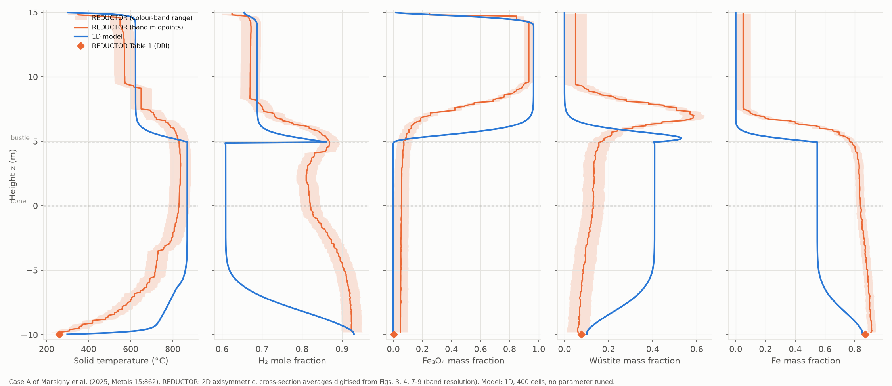

| Quantity (Table 1) | REDUCTOR | Model, 400 cells | Difference | Converged estimate |
|---|---|---|---|---|
| Metallisation (%) | 93.3 | 91.6 | −1.7 | 90.6 (−2.7) |
| DRI temperature (°C) | 261 | 298 | +37 | 307 (+46) |
| Top gas temperature (°C) | 344 | 360 | +16 | 359.6 (+16) |
| Top gas H2 / H2O (%) | 64.1 / 30.9 | 65.5 / 29.5 | +1.4 / −1.4 | |
| GUD | 0.33 | 0.310 | −0.020 | 0.308 (−0.022) |
| DRI Fe / FeO / Fe3O4 (wt-%) | 87.16 / 7.71 / 0.5 | 85.2 / 10.2 / 0 | −2.0 / +2.5 / −0.5 | |
| DRI flow (t/h) | 117.19 | 117.7 | +0.5 | |

Profile agreement with the band range (`scripts/compare_reductor.py`; 0.1 m points; excess = distance outside the band):

| Quantity | Above the bustle: within band / mean excess | Below the bustle: within band / mean excess |
|---|---|---|
| Solid temperature | 26 % / 18 K | 40 % / 67 K |
| H2 mole fraction | 75 % / 0.013 | 4 % / 0.19 |
| Fe3O4 mass fraction | 18 % / 0.16 | 8 % / 0.005 |
| Wüstite mass fraction | 56 % / 0.11 | 2 % / 0.21 |
| Fe mass fraction | 73 % / 0.085 | 0 % / 0.24 |

(Low "within band" with a near-zero excess, e.g. Fe3O4 below the bustle, means the model lies just outside a narrow band.)

### Where and why the models differ

1. **The outlet values agree within a few percent, but the axial path does not.** That agreement is partly compensation (different paths, similar end points), so it is not a validation of the 1D path.
2. **Upper shaft: similar zones.** Both models have:
   - hematite gone near the top (REDUCTOR within ~0.3 m, the model within ~1 m);
   - a long low-temperature plateau where magnetite waits (model ~620 °C, REDUCTOR 500–650 °C).

   **But the model's magnetite → wüstite → iron front lies about 1.5–2 m lower.**
   - In REDUCTOR the bustle gas enters at the wall at 890 °C. The outer annulus, which carries most of the cross-section, is reduced above the bustle (Fig. 9), while a narrow, H2-starved core stays wüstite down to the outlet; the paper reports this.
   - A 1D model spreads the bustle gas over the whole cross-section, so the burden reaches the bustle less reduced: Fe mass fraction ~0.55 against ~0.8.
3. **Below the bustle the regimes differ.**
   - In 1D only the 500 mol/s of cooling gas flows there. It meets a burden still holding ~40 % wüstite and reaches the Fe/wüstite equilibrium (x_H2 ≈ 0.61), so reduction stops until the bottom of the cone, where the gas is fresh.
   - In REDUCTOR the burden arrives mostly reduced and the cooling gas stays H2-rich (x_H2 0.83–0.9).
4. **Cooling zone.**
   - The cooling gas has a much smaller heat-capacity flow than the burden, so in 1D it is heated to the burden temperature within the last metre. The burden stays near 870 °C down to z ≈ −6 m and is cooled in a thin front at the outlet.
   - REDUCTOR cools the burden gradually through the whole cone, presumably through the 2D gas distribution in the converging cone.
   - The 1D DRI therefore leaves hotter, and this front is what makes the 1D results grid-sensitive.
5. **Top gas.** It is 16 K hotter, consistent with less endothermic reduction overall (lower metallisation) and a hotter burden below the bustle.

Points 2–4 are interpretations of the comparison, not tested hypotheses. Testing them would need a radial (2D) model, or at least a two-zone (core/annulus) 1D variant.

### Limitations of the comparison

- 1D plug flow against a 2D model with radial gas distribution. The paper itself shows strong radial gradients (unreduced core), which no 1D model can represent.
- The reference profiles are digitised colour bands: ±1 band, plus misclassified edge pixels, and the r-weighted average assumes axisymmetric plug flow of the solid (REDUCTOR's solid flow is not plug flow in the cone).
- One constant pressure; no pressure drop computed. The REDUCTOR pressures are used as boundary values. (Milestone 8 adds an Ergun pressure field: it matches REDUCTOR's upper shaft within about 10 % and changes case A by less than 4e-4 in metallisation.)
- Pellet properties other than diameter and hematite content are those of the Milestone 2 Vale pellets. The case A pellet properties are not published.
- The kinetics come from the same group as REDUCTOR (refitted in Milestone 2), and both models use the three-step model without a direct Fe3O4 → Fe path. Agreement or disagreement therefore says little about the kinetics.
- Grid: the 400-cell results are 0.010 from the converged metallisation and 9 K from the converged DRI temperature (first order; Milestone 8 grid study to 3200 cells).
- With the alternating solver the 400-cell case takes 15 min, too slow for Milestone 6 sampling; Milestone 6 samples on 50 cells and checks the effect of the grid on the spreads (see below). The coupled solver of Milestone 8 solves fine grids in 1–2 min from a coarser solution, but cold starts still go through the alternating solver.

The notebook `notebooks/05_reductor_comparison.ipynb` reproduces the tables and the figure.

---

## Milestone 6 – Uncertainty quantification (whole furnace, case A)

Question: how much do the case A outputs move when the inputs with a citable or data-derived uncertainty are varied, and which of them matters most?

### Uncertain inputs (`data/uncertainty.yaml`)

| Group | Inputs | Distribution | Source |
|---|---|---|---|
| Kinetics | ln k_j at 1023.15 K and Ea_j of the three steps (6 parameters) | Multivariate normal around the Milestone 2 refit. Covariance: jackknife over the seven TGA temperature curves (leave one curve out). Sampled along the principal axes and truncated at ±3σ | Marsigny 2025, Fig. 6 (refit, `data/kinetics_refit.yaml`) |
| Tortuosity | Pellet pore tortuosity (nominal 2) | Uniform on [1, 3] | Marsigny 2025, §3.5.3 ("in the range of 1–3") |
| Transfer correlation | Blend λ between Wakao–Kaguei (λ = 0, nominal, packed bed) and Ranz–Marshall (λ = 1, single sphere) for gas–solid heat and mass transfer | Uniform on [0, 1] | Wagner 2008; Marsigny 2025 thesis, eq. 12 |

Notes on the choices:

- **Kinetic covariance.** The Jacobian (least-squares) covariance treats the ~40 points of each curve as independent. It underestimates the scatter between curves; for example, the Ea3 SD is 0.85 kJ/mol from the Jacobian and 5.3 kJ/mol from the jackknife. The jackknife is used, and both are stored in `data/kinetics_refit.yaml`.

  | | ln k1 | Ea1 | ln k2 | Ea2 | ln k3 | Ea3 |
  |---|---|---|---|---|---|---|
  | Jackknife SD | 0.086 | 9.8 kJ/mol | 0.073 | 2.8 kJ/mol | 0.052 | 5.3 kJ/mol |

- **Transfer correlation.** No published accuracy figure for Wakao–Kaguei was found. The spread between the two correlations used in the literature stands in for it; Ranz–Marshall gives 0.3–0.5× the Wakao–Kaguei coefficients here.
- **Tortuosity and kinetics are coupled.** The kinetic constants were fitted with tortuosity 2, so varying tortuosity alone overstates its effect (a refit would partly compensate). Its Sobol share below is an upper bound.
- **Not varied (no citable range):**
  - the pellet properties of case A (porosity, grain size, density), which are not published;
  - the operating conditions, which are fixed by case A;
  - the pressure (one value; local deviations ≤ 14 %, Milestone 5);
  - heat losses and radiation, which are not modelled;
  - the 1D plug-flow assumption itself.

### Speed and numerical settings

- **Shared property tables.** Samples reuse the base problem's property tables (`ThermalProblem.with_parameters`).
  - Kinetics enter as the exact Arrhenius ratio k_tab/k_new at the solid temperature, matching rebuilt tables to < 1e-5 (tested).
  - Tortuosity scales the diffusion term exactly (tested to 1e-12).
  - λ blends the two transfer tables exactly; λ = 1 equals tables built with Ranz–Marshall (tested).
- **Solver.** Shooting uses Brent on the monotone miss function.
- **Sampling tolerances.** Samples use `tol_T = 1e-4 K` and `species_tol = 1e-8`, which change metallisation by < 1e-6.
  - 17 of 1792 runs (6 Monte Carlo, 11 Sobol, all at tortuosity ≥ 1.9) were flagged unconverged. Their outer iteration had met `tol_T`, but the final consistency re-solve moved the temperature by slightly more than `tol_T`.
  - `uq.run_one` re-solves such runs from their end state with `tol_T = 1e-5`. All then converged, and metallisation changed by ≤ 2e-7. The re-solved runs are listed in the result files.
  - No unconverged result is used.
- **Throughput.** 50 cells: **24.6 runs/min** on 6 worker processes (median 13.8 s per run; 8.6 s for a single run alone). 12 workers were slower (21.2 runs/min). The full study (512 + 1280 runs) took about 1.5 h.
- **Grid.** 50 cells is not grid-converged; this is known from Milestone 5, and the grid check below quantifies it.

### Monte Carlo (512 Latin-hypercube samples, 50 cells, seed 2026)

| Output | Nominal | Mean | SD | 5 % | 50 % | 95 % |
|---|---|---|---|---|---|---|
| Metallisation (-) | 0.9456 | 0.9460 | 0.0043 | 0.9400 | 0.9455 | 0.9536 |
| H2 consumption (kg/t DRI) | 48.85 | 48.88 | 0.21 | 48.58 | 48.85 | 49.25 |
| Top gas (°C) | 363.0 | 363.1 | 0.32 | 362.7 | 363.1 | 363.6 |
| DRI (°C) | 268.3 | 267.4 | 4.2 | 260.1 | 267.8 | 273.2 |
| Peak solid (°C) | 812.5 | 811.5 | 4.2 | 804.4 | 811.7 | 817.6 |
| GUD (-) | 0.3165 | 0.3166 | 0.0009 | 0.3153 | 0.3165 | 0.3182 |

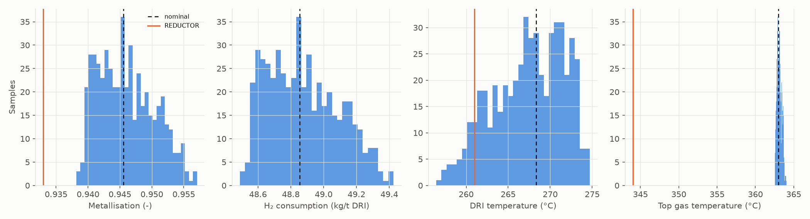

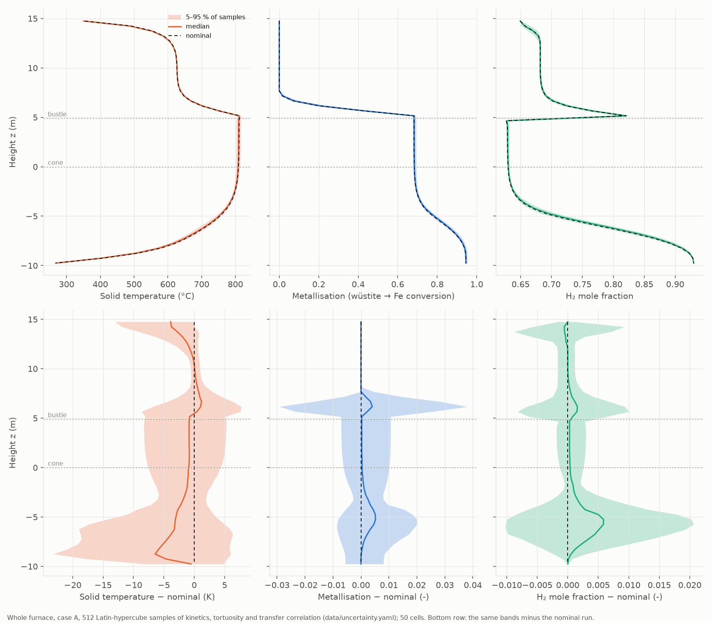

- From 128 to 512 samples the mean and the 5/95 % quantiles change by less than 0.0005 in metallisation and 0.7 K in DRI temperature (`figures/uq_convergence.png`).
- The spread is concentrated at the reduction front above the bustle (z ≈ 5–8 m) and at the cooling front in the cone.
- The REDUCTOR values (metallisation 0.933, top gas 344 °C) lie **outside** the sampled ranges. Within these uncertainties, the gaps to REDUCTOR found in Milestone 5 are not explained by kinetics, tortuosity or the transfer correlation. The 1D-vs-2D model form and the grid error (below) are each larger.

### Sobol indices (grouped; Saltelli design, N = 256, 1280 runs; 95 % bootstrap intervals)

| Output | Kinetics S1 / ST | Tortuosity S1 / ST | Transfer correlation S1 / ST |
|---|---|---|---|
| Metallisation, H2 consumption, GUD | 0.22±0.07 / 0.22±0.05 | 0.78±0.14 / 0.80±0.12 | 0.00 / 0.00 |
| DRI temperature | 0.24±0.08 / 0.24±0.05 | 0.75±0.14 / 0.77±0.12 | 0.01 / 0.01 |
| Top gas temperature | 0.29±0.08 / 0.28±0.06 | 0.65±0.13 / 0.67±0.11 | 0.06±0.04 / 0.06±0.01 |
| Peak solid temperature | 0.18±0.07 / 0.18±0.04 | 0.80±0.14 / 0.80±0.12 | 0.02 / 0.02 |

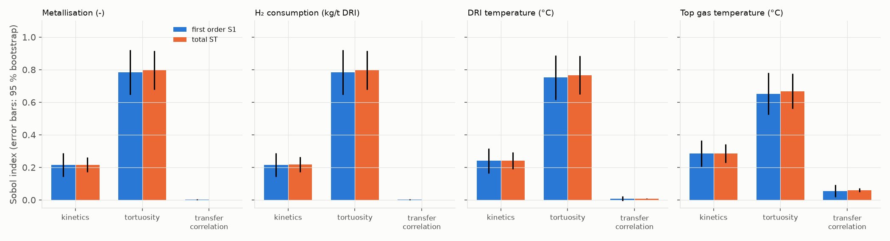

- Metallisation, H2 consumption and GUD are all linear in the oxygen removed, so they have identical indices.
- S1 ≈ ST and the S1 values sum to about 1, so the response is close to additive in the three groups: no material interactions.
- **Tortuosity dominates** (about 0.8), but this is an upper bound (see the coupling note above).
- The kinetic uncertainty, as constrained by the TGA data, contributes about 0.2.
- The choice of transfer correlation hardly matters. Its largest effect is on the top gas temperature, 6 % of a variance whose SD is only 0.3 K.
- With N = 256 the intervals are ±0.05–0.14. They are wide, but the ranking is unambiguous.

### Grid check (first 24 Monte Carlo samples on 200 and 400 cells)

| Output | Mean offset 200 / 400 cells | SD ratio fine/50: 200 / 400 cells | Correlation with 50 cells: 200 / 400 |
|---|---|---|---|
| Metallisation | −0.021 / −0.028 | 0.72 / 0.67 | 0.94 / 0.89 |
| Top gas (°C) | −2.1 / −2.6 | 0.68 / 0.63 | 0.99 / 0.97 |
| DRI (°C) | +22 / +29 | 0.68 / 0.62 | 0.97 / 0.93 |
| Peak solid (°C) | +46 / +57 | 0.99 / 0.93 | 0.96 / 0.91 |

- **Mean offsets.** These are the discretisation error of the 50-cell grid and match the Milestone 5 grid study, which is not converged at 400 cells either.
  - At 50 cells this error is **larger than the parameter spread**: 6–7× the SD in metallisation and DRI temperature.
  - The 50-cell means in the Monte Carlo table are therefore not estimates of the converged furnace.
- **Spreads.** The SD ratio is 0.72 from 50 to 200 cells and 0.93 from 200 to 400 cells, so it is settling, at about **0.65×** the 50-cell spread (peak solid temperature about 0.93×).
  - The 50-cell spreads are therefore conservative, about 1.5× too wide.
  - Fine-grid estimates (400 cells, 24 samples): metallisation SD ≈ 0.0022, DRI SD ≈ 2 K, top gas SD ≈ 0.2 K.
- **Correlation.** 0.89–0.97 between grids: the samples keep their order, so the Sobol ranking is not a grid artefact.

### Tests (`tests/test_uq.py`, 12 tests)

| Test | Checks |
|---|---|
| Kinetic / tortuosity factors vs rebuilt tables | < 1e-5 / < 1e-12 relative |
| Transfer blend | λ = 1 equals Ranz–Marshall tables; λ = 0.5 is the mean |
| `with_parameters` | shares tables; rejects table-defining fields |
| θ ↔ (k0, Ea) | round trip to 1e-12 |
| Latin hypercube | one point per stratum in every dimension; reproducible by seed |
| Sample ranges | tortuosity and λ within bounds; kinetics within ±3σ along the principal axes |
| Zero uncertainty | every run equals the deterministic one (1e-10) |
| Reproducibility | identical outputs with a fixed seed, serial and in 2 processes |
| Statistics | summary quantiles, profile bands, running statistics |

### Limitations

- Only three groups of inputs are varied. The model-form error (1D plug flow against a 2D furnace, Milestone 5) and the grid error are both larger than the parameter spread found here, so these intervals are **not** uncertainty intervals for the real furnace. They rank the parametric sensitivities of this model.
- The tortuosity share is an upper bound (coupled to the kinetic fit), and its range is a plausibility range from the paper, not a measurement.
- The kinetic covariance rests on seven TGA curves of one pellet type at one gas composition. Extrapolation to furnace conditions (other H2O fractions, lower temperatures in the cone) is not covered by that spread.
- Uniform distributions on the tortuosity and λ ranges are a choice; other shapes would change the quantiles.
- The Sobol and Monte Carlo runs are on 50 cells. The spreads are checked on finer grids for 24 samples only.

Reproduce (about 2.5 h on 6 cores, most of it the 400-cell check):

```
python scripts/run_uq.py mc
python scripts/run_uq.py sobol
python scripts/run_uq.py grid
python scripts/run_uq.py grid --cells 400
python scripts/plot_uq.py
```

The notebook `notebooks/06_uncertainty.ipynb` reads `results/uq/` and reproduces the tables and figures.

---

## Milestone 7 – Operating cases, sensitivities, CO2 and the app

### Data (all fetched and checked by scripts; sources in `data/SOURCES.md`)

| Data | File | How it was obtained and checked |
|---|---|---|
| Inputs and outputs of REDUCTOR cases A–E | `data/furnace_cases.yaml`, `tests/data/reference_model_marsigny2025b_cases.csv` | Read from the page image of Table 1. Every value occurs in the PDF text layer; the case A column equals the Milestone 5 file. Per-case consistency checks found three inconsistencies in the source, which are kept as printed: case B GUD 0.33 where its top gas gives 0.315, and top-gas flows of cases C and E 7 and 34 mol/s below the inlet total (`scripts/extract_reductor_cases.py`) |
| Metallisation vs cooling gas flow (Fig. 10) | `tests/data/reference_model_marsigny2025b_fig10.csv` | Bars digitised from the embedded image, axis calibrated on the ticks (residual 0.002 %). The 500 and 700 mol/s bars reproduce Table 1 (cases A, B) within 0.03 % (`scripts/digitize_reductor_fig10.py`) |
| Energy demand of case A from the authors' gas-loop model | `tests/data/reference_energy_marsigny2025_thesis_t20.csv` | Thesis Table 20, rows checked verbatim, parts add up (`scripts/extract_thesis_table20.py`) |
| Electrolysis 18 MJ/Nm³ H₂, heater efficiency 0.7, condenser exit 70 °C; natural-gas DRI and route benchmarks | `data/emissions.yaml` | Quotes checked by `tests/test_provenance.py`. The normal cubic metre (0 °C, 101.325 kPa, DIN 1343) converts 18 MJ/Nm³ to 403 kJ/mol = 55.6 kWh/kg H₂ |
| Grid CO2 intensity (life-cycle), South Africa, world, France, 2015–2025 | `data/grid_intensity.yaml` | Ember yearly data, downloaded by `scripts/fetch_grid_intensity.py` |
| Sensitivity ranges | `data/sensitivity.yaml` | Bustle temperature 815–950 °C (cases D and C); bustle flow 2000–2430 mol/s (Fig. 10 low end; case E's gas-to-solid ratio); pellet diameter 10–15 mm (Marsigny thesis: "porous pellets in blast furnaces and shaft furnaces (dp = 10-15 mm)") |

### Code

- `shaftsim.operating`:
  - `OperatingConditions`: bustle and cooling flows and temperatures, gas composition, burden flow and temperature, pellet diameter, mean pressure.
  - Functions to read conditions from a case, apply them to a case, and load the REDUCTOR cases.
  - Tests: case A from `furnace_cases.yaml` equals `furnace.yaml` to 1e-12, round trip, validation.
- `shaftsim.emissions`: electricity per kg of DRI (electrolysis for the H₂ consumed, plus bustle-gas heating) and CO2 for a grid intensity.
  - The heating is the enthalpy rise of the bustle gas from 70 °C, divided by the heater efficiency. The gas loop's heat exchanger is not modelled, so this term is an upper bound.
  - Tests: unit conversions, heating = ∫Cp dT, arithmetic, and case A against the thesis.
- `shaftsim.scenario`: one operating point → KPIs, profiles, energy and balance closures (used by the app).
- `uq.run_one` now also records the energy closure.

### Energy demand of case A vs the authors' gas-loop model

| GJ per t DRI | Model, 50 cells | Model, 200 cells | Thesis Table 20 |
|---|---|---|---|
| Electrolysis | 9.78 | 9.56 | 9.73 |
| Gas heating | 2.49 (no heat recovery) | 2.47 | 2.28 |
| Compression (Milestone 8) | 0.20 | 0.20 | 0.25 |
| Total | 12.47 | 12.24 | 12.26 |

- Electrolysis follows from the H₂ consumption, so it agrees as well as the H₂ consumption does (−2 % on 200 cells).
- The heating term is within 10 % of the paper's, although the heat exchanger is not modelled.
- Compression (isothermal, Shao et al. 2021; Milestone 8) is 19 % below the thesis value; the totals agree within 2 %.
- A test checks case A on 50 cells against the thesis values (2 % for electrolysis, 5 % for the total).

### REDUCTOR cases B–E: change from case A, model vs REDUCTOR

No parameter was changed between cases except the operating conditions of Table 1. The 200-cell entries for B and E ("n.c." in Milestone 7) were solved by the coupled solver of Milestone 8 (marked ¹); all other entries are unchanged.

| Case (what changes) | Output | 50 cells | 100 cells | 200 cells | REDUCTOR |
|---|---|---|---|---|---|
| B (200 mol/s from bustle to cooling) | metallisation (% pts) | −7.0 | −5.7 | −4.4¹ | +0.4 |
| | DRI T (K) | −194 | −209 | −221¹ | −95 |
| | top gas T (K) | −5.4 | −4.2 | −3.3¹ | −3 |
| C (32 % N₂, bustle 950 °C) | metallisation | +1.0 | +2.0 | +2.9 | −0.1 |
| | top gas T | +41 | +41 | +41 | +50 |
| | DRI T | +68 | +63 | +56 | +141 |
| | GUD | +0.129 | +0.131 | +0.132 | +0.14 |
| D (burden at 1200 °C, bustle 815 °C) | metallisation | +5.4 | +6.3 | +7.6 | +0.8 |
| | top gas T | +429 | +436 | +456 | +462 |
| | DRI T | +120 | +84 | −27 | +69 |
| E (burden 43 kg/s) | metallisation | +5.4 | +6.3 | +7.6¹ | +6.7 |
| | top gas T | +12 | +12 | +13¹ | +9 |
| | DRI T | −12 | −21 | −33¹ | +142 |

Reading the table:

- **Reproduced:**
  - the top-gas temperature response to N₂ dilution (C) and to a hot burden (D), within 10 K of 50 K and 462 K;
  - the gain in gas utilisation with N₂ (+0.13 vs +0.14);
  - full metallisation in case E.
- **Not reproduced: the DRI temperature.**
  - In REDUCTOR the DRI is 140 K hotter in cases C and E. In the model it is +56 K and −20 K.
  - This is the cooling-zone difference of Milestone 5: in 1D the burden is cooled in a thin front at the outlet, whose temperature is set by the cooling gas.
- **Metallisation changes are larger than REDUCTOR's in B, C and D.**
  - Case A in 1D is less reduced at the bustle (Milestone 5), so it gains more from a hotter or better-supplied upper shaft.
  - In D the model reaches full metallisation, against REDUCTOR's 94.1 %.
  - Case D (burden at 1200 °C) lies 300 K above the temperature range of the kinetic data (TGA at 600–900 °C), so it is an extrapolation. Bustle gas at 950 °C (case C, top of the temperature sweep) lies 50 K above it.
- **Case D's DRI temperature is not grid-converged** (+120 → +84 → −27 K from 50 to 200 cells).

### Cooling-gas flow: a regime change of the 1D model

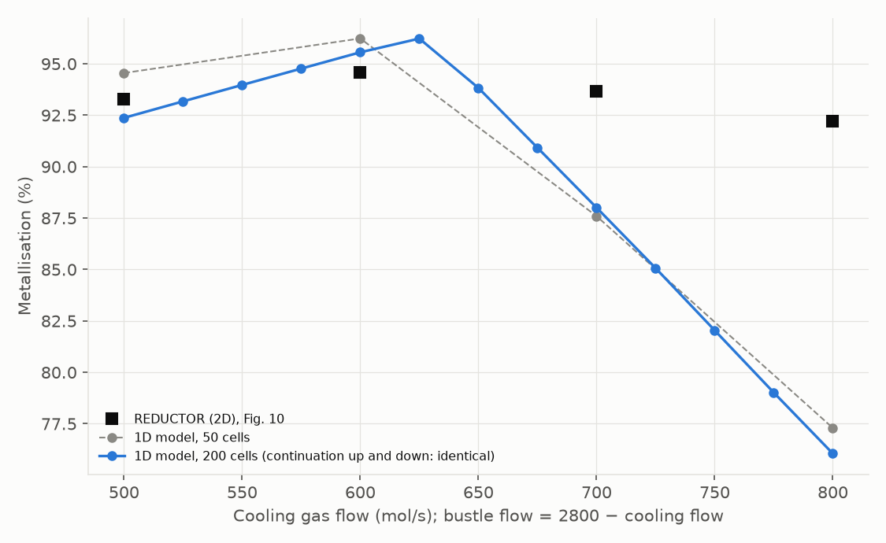

Case B conditions, cooling flow 500–800 mol/s at a constant total of 2800 mol/s. On 200 cells the sweep was solved by continuation upward from 500 and downward from 800 mol/s (`scripts/run_cooling_continuation.py`).

| Cooling flow (mol/s) | 500 | 550 | 600 | 625 | 650 | 700 | 750 | 800 |
|---|---|---|---|---|---|---|---|---|
| Metallisation, 200 cells (%) | 92.4 | 94.0 | 95.6 | 96.2 ¹ | 93.8 ¹ | 88.0 ¹ | 82.0 ¹ | 76.1 |
| DRI T, 200 cells (°C) | 291 | 210 | 122 | 77 ¹ | 70 ¹ | 70 ¹ | 70 ¹ | 70 |
| Metallisation, 50 cells (%) | 94.6 | | 96.2 | | | 87.6 | | 77.3 |
| REDUCTOR, Fig. 10 (%) | 93.3 | | 94.6 | | | 93.7 | | 92.2 |

¹ Unsolved in Milestone 7 (625–750 mol/s); solved in Milestone 8 by the coupled solver, started from the converged neighbouring flow or from the half grid.

- **Up to 625 mol/s**, the model reproduces Fig. 10's trend, with its optimum at 625 mol/s (96.2 %; REDUCTOR's is near 600): more H₂ reaches the lower shaft, while the burden is still cooled in a thin front at the outlet. That front cools by about 45 K for every 25 mol/s.
- **Above about 750 mol/s**, the cooling gas cools the whole lower cone. The DRI leaves at the gas inlet temperature (70 °C) and wüstite reduction stops in the cold cone, so metallisation falls to 76 % at 800 mol/s. REDUCTOR declines only to 92 %, presumably because its cooling gas is distributed in 2D and a hot core remains.
- **Between the two regimes** (625–750 mol/s), the heat-capacity flows of the cooling gas and the reduced burden in the cone are nearly equal, and the cooling front can sit anywhere in the cone. The alternating iteration cycles there (a period-2 oscillation: near the front, a cell's wüstite runs out or not depending on its temperature). Milestone 7 reported these points as unsolved.
  - **Milestone 8** solves them with a fully coupled Newton solver. The curve is continuous: metallisation falls steadily from 96.2 % at 625 mol/s to 76.1 % at 800 mol/s as the DRI leaves at the cooling-gas temperature (70 °C).
  - Both continuation branches (up from 500, down from 800 mol/s) now converge at every flow and agree exactly: no hysteresis.
- Case B itself (700 mol/s) and case E converge on 200 cells too (table above).

### Sensitivities (one at a time around case A)

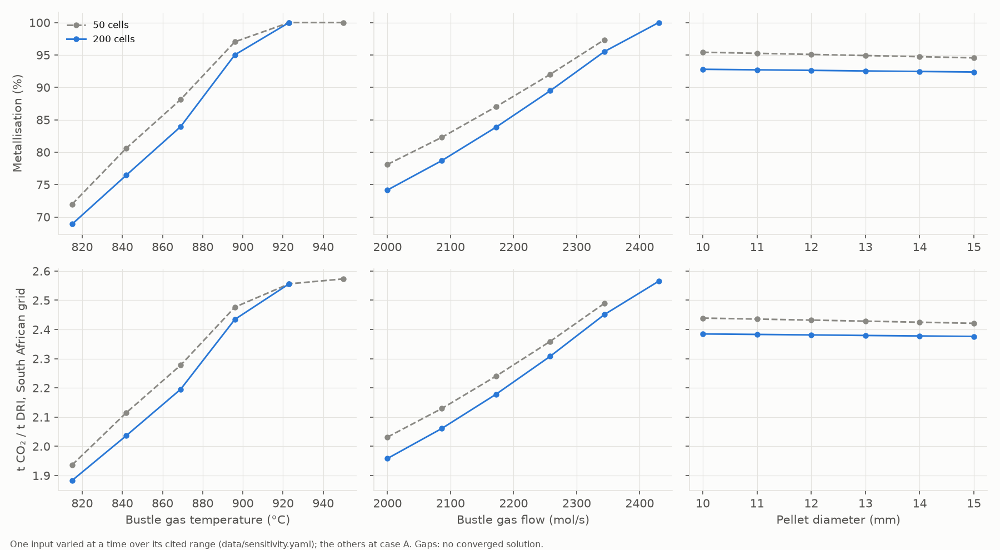

| Input over its range | Metallisation, 200 cells | H₂ (kg/t DRI) | t CO2/t DRI, SA grid |
|---|---|---|---|
| Bustle gas 815 → 923 °C (950 °C: n.c.) | 0.689 → 1.0 | 37.0 → 51.6 | 1.88 → 2.56 |
| Bustle flow 2000 → 2430 mol/s | 0.742 → 1.0 ¹ | 39.3 → 51.6 | 1.96 → 2.57 |
| Pellet diameter 10 → 15 mm | 0.928 → 0.924 | 48.0 → 47.8 | 2.38 → 2.38 |

CO2 includes compression (Milestone 8). ¹ The 2430 mol/s endpoint was unsolved in Milestone 7 and is solved by the coupled solver in Milestone 8; the 950 °C endpoint on 200 cells (and the 2430 mol/s endpoint on 50 cells) still do not converge.

- **Heat and gas supply dominate.**
  - Over the ranges spanned by the paper's own cases, the bustle temperature and flow move metallisation by 0.2–0.3.
  - Both act mainly on wüstite reduction around the bustle, the stage Milestone 5 found starved in 1D.
- **Pellet size hardly matters here** (−0.004 from 10 to 15 mm). Wüstite reduction is limited by heat and H₂ supply, not by diffusion in the pellet. Wagner (2008) reported a strong size effect with other kinetics, and the kinetics here come from one pellet type, so this should not be generalised.
- **H₂ and CO2 per tonne rise with metallisation** because more oxygen is removed. The rise reflects a more reduced product, not a less efficient one.
- The 50-cell curves have the same shape, offset by the known grid error.
- Of the endpoints at full metallisation, 950 °C still does not converge on 200 cells (nor 2430 mol/s on 50 cells), even with the coupled solver; they are left out.

### CO2 per tonne of DRI and the electricity grid

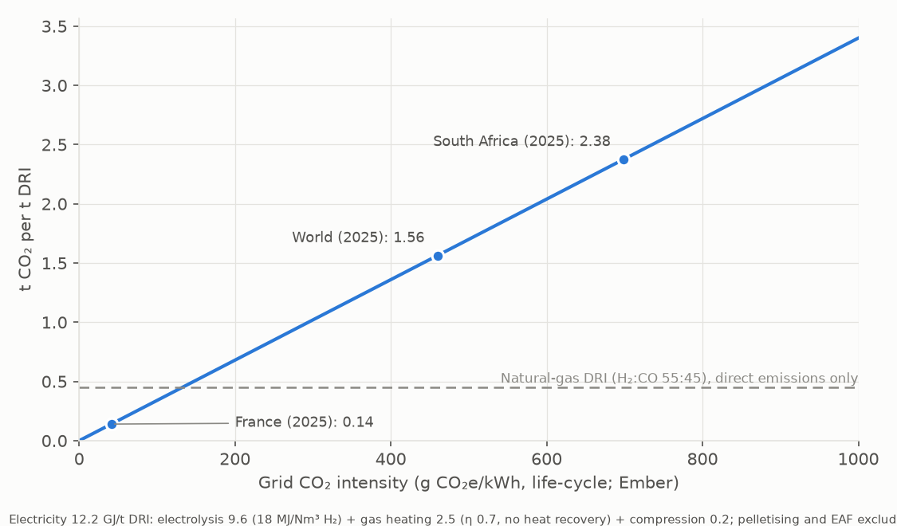

Case A on 200 cells needs 12.2 GJ of electricity per t DRI: 9.6 for electrolysis, 2.5 for heating and 0.2 for compression (added in Milestone 8).

| Grid (Ember 2025, life-cycle) | g CO2e/kWh | t CO2/t DRI |
|---|---|---|
| South Africa | 699 | 2.38 |
| World | 460 | 1.56 |
| France | 41 | 0.14 |
| Break-even with natural-gas DRI (0.45 t/t direct) | 132 | 0.45 |

- **On South Africa's grid**, hydrogen DRI emits about 5× the direct emissions of a natural-gas shaft furnace (H₂:CO 55:45, thesis Table 20). It also emits more per tonne of DRI than the BF-BOF route emits per tonne of crude steel (2.2 t/t, IEA 2020), although those two numbers have different system boundaries.
- **Hydrogen DRI pays off only below about 130 g/kWh**, i.e. on dedicated renewables or a low-carbon grid.
  - The natural-gas figure excludes upstream methane and electricity, so the true break-even is somewhat higher.
- The grid is the dominant lever: within the cited operating ranges, the furnace itself changes CO2 per tonne by −21 % to +8 % around case A (1.88–2.57 t/t on the SA grid). Most of that change comes with a change of product (metallisation).

### App (`app/streamlit_app.py`)

- **Inputs:** sliders over the cited ranges (bustle temperature and flow, cooling flow, N₂ fraction, burden flow, pellet diameter), REDUCTOR presets A, B, C and E, a grid choice (South Africa, world, France or custom), and 50 or 100 cells.
- **Outputs:**
  - KPI tiles and REDUCTOR's values when a preset is unchanged;
  - three profile charts (temperatures, gas, step conversions), with legends, direct labels and a table view;
  - CO2 against grid intensity;
  - an "Assumptions and limits" panel.
- **Behaviour:** about 15 s per run on 50 cells, with cached results. Unconverged runs are flagged as errors.
- **Tests:** `tests/test_app.py` runs the app headless (Streamlit AppTest) on case A and switches to case C.
- **Running it:** locally (`streamlit run app/streamlit_app.py`); the app is not hosted. `requirements.txt` would let it be deployed on Streamlit Community Cloud.
- **CI:** `.github/workflows/ci.yml` runs ruff, mypy and pytest on Python 3.11 and 3.12. The provenance tests that need the downloaded papers are skipped in CI.

### Limitations of Milestone 7

- **Model form.** All of Milestones 5–6 applies: 1D plug flow, one mean pressure, no heat losses, kinetics from one source, and pellet structure from another pellet type.
- **Grid.** Results on 200 cells are still about 0.01–0.015 from the converged metallisation (Milestone 5). Changes between operating points are less grid-sensitive than absolute values, except where the cooling front changes regime.
- **Solver.** The alternating iteration does not converge where the cooling front is balanced inside the cone, or in some fully reduced cases on fine grids. Milestone 8's coupled solver solves all of these except two full-metallisation endpoints of the sensitivity sweeps, which are reported as unsolved, never as results.
- **Kinetic range.** The kinetics were fitted at 600–900 °C. Case D (1200 °C burden) is an extrapolation, and bustle gas at 950 °C a mild one.
- **Energy and CO2.**
  - Covered: electrolysis, bustle-gas heating (no heat recovery) and, since Milestone 8, gas compression.
  - Not covered: heat recovery, pelletising, the EAF, plant construction and upstream emissions of natural gas.
  - Grid intensities are annual averages; an electrolyser running on hourly surplus renewables would see a different intensity.

The notebook `notebooks/07_analysis.ipynb` reproduces the tables and figures from `results/`.

---

## Milestone 8 – Numerics and pressure

Plan (PLAN.md, approved 2026-11-06): a fully coupled solver, a second-order scheme, the Ergun pressure drop, gas-loop energy terms if a source is open, then the Milestone 5 and 7 comparisons rerun. Each step was time-boxed (about 2 h); a missed target is reported here, not relaxed.

### Acceptance targets: outcome

| Target (PLAN.md) | Outcome |
|---|---|
| Coupled solver converges where the alternating one cycles (case B sweep 625–750 mol/s, 200 cells) | **Met**: 600–750 mol/s all converge (28–54 s each) |
| Coupled = alternating where both converge (1e-8) | **Met**: case A, 50 cells, metallisation 7e-11, temperatures 7e-9 K (no smoothing) |
| Balance closure 1e-12 | **Met** (element and energy closures at round-off, all schemes) |
| Smoothing effect on outputs below 1e-6 | **Met, narrowly**: at most 9e-7 in metallisation (750 mol/s); case A 4e-8 |
| Observed order about 2 on the reaction-free reference | **Met**: 1.92–1.99 (second-order scheme) |
| 100 cells within 0.005 of the extrapolated metallisation | **Missed** by both schemes (about 0.02 off): the reacting solution has kinks |
| Case A on 200 cells under 2 min | **Met**: 86 s |
| Ergun pressures compared with REDUCTOR (not tuned) | Done: upper shaft −9 % to +13 %, cone 0.9–3.9× |
| Gas-loop terms from Shao et al. (2021) if open | Compression added; the paper has no heat-recovery term |

### Coupled solver (`shaftsim/coupled.py`)

- **Unknowns and equations.** All six unknowns of a cell (three step conversions, H2 fraction, two temperatures) are solved in one sparse Newton system. The equations are exactly those of the alternating scheme, so where both converge they give the same solution.
- **Variables.** The conversions are solved as unreacted-core radii u = (1 − X)^(1/3). In X the rate falls like (1 − X)^(2/3), whose slope is infinite at complete conversion, and Newton steps overshoot.
- **Globalisation.** Pseudo-transient continuation with a backtracking line search; projection onto the physical bounds; an active set for core radii at complete conversion, and a release step that lifts such a radius when its equation asks it to grow (its slope vanishes there).
- **Jacobian.** Coloured finite differences (block-banded). The step in u must be far below the smoothing width: with 1e-7 the Jacobian was about 10 % wrong inside the transition and Newton converged only linearly, one cell per iteration. 1e-9 restores quadratic convergence.
- **Why smoothing is needed.** The availability rule (step 3 limited by step 2 once wüstite runs out) is a switch: where a cell sits on it, the discrete equations have no exact root, and every solver stalls at a residual of about 1e-6. The switch is replaced by a smoothstep over a gap of 1e-5 in conversion, and the minimum of the two rates by a p-norm minimum (relative width 1e-5) that is exactly zero when either rate is zero. A first smooth minimum of the usual square-root form gave a small negative rate behind a step at equilibrium and had to be replaced.
- **Smoothing effect.** Case A: metallisation −4e-8, DRI +9e-5 K. Case B sweep: 1.7e-7 to 9.1e-7 in metallisation (largest at 750 mol/s), temperatures within 1e-4 K. Widths 1e-3 → 1e-4 → 1e-5 move metallisation by 5.5e-5 and 3.9e-6, about 14× less per decade.
- **Use.** The alternating solver stays first. The coupled solver takes over only where it fails (`coupled.rescue`, used by `scenario.run_scenario`, `uq.run_one` and the sensitivity and continuation scripts; starts described under Reruns below), so every result that converged before is unchanged. It is a finisher, not a cold-start solver: at 775 mol/s it fails from a coarse start where the alternating solver converges in 18 s.

### Second-order scheme (option, not the default)

MUSCL faces with the van Albada limiter applied to gradients (second order across segment junctions of different cell height), regularised where both gradients vanish, first-order end cells. Conservative: the balances close to round-off.

| Cells | Top gas error, first order (K) | Second order (K) |
|---|---|---|
| 25 | 7.8 | 0.72 |
| 50 | 3.9 | 0.19 |
| 100 | 2.0 | 0.049 |
| 200 | 0.99 | 0.012 |
| 400 | 0.50 | 0.0031 |

Reaction-free case (h × 3e-3) against the RK45 shooting reference of Milestone 4: observed order 1.92–1.99.

**With reactions the gain is small.** Case A metallisation, second order: 0.9319 (100 cells), 0.9195 (200 cells), against an extrapolated value near 0.91. The solution has kinks (X3 pinned to X2, rates switching off at equilibrium, the thin cooling front at the outlet), where any scheme is first order. Second order there is worth about a factor 2 in cells, not an order. The coupled solver also fails to converge with it on 40, 50 and 400 cells (in the zone where the gas is buffered at the magnetite/wüstite equilibrium). It therefore stays an option (`scheme=2`) for smooth problems; the first-order scheme remains the default.

### Pressure field (Ergun, `shaftsim/pressure.py`)

- Ergun (1952) as given by Wagner (2008, p. 90): −dP/dh = [150 (1 − ε)² μ / (ε³ d²) + 1.75 (1 − ε) ρ u / (ε³ d)] u. With the ideal gas, dp/dz = C/p in each cell, so p² is integrated exactly from the top pressure (150 kPa, a boundary value).
- Local pressure enters only the pellet kinetics, by exact rescaling of the tables: a_chem ∝ 1/p, the Knudsen part of the pore resistance ∝ 1/p (Bosanquet); external transfer and heat transfer do not depend on p. Pressure and solution are iterated to a fixed point (2 iterations).
- Optional (`ThermalProblem.pressure_cells`); the default stays the mean pressure of Milestone 5.

Against REDUCTOR Table 1 (outputs, `tests/data`), 100 cells, nothing tuned:

| Case | Bustle, model / REDUCTOR (kPa) | Top→bustle Δp, model/REDUCTOR | Cone Δp, model / REDUCTOR (kPa) | Cooling inlet, model / REDUCTOR (kPa) |
|---|---|---|---|---|
| A | 180.0 / 180.4 | 0.99 | 4.6 / 1.2 | 184.6 / 181.6 |
| B | 179.1 / 179.6 | 0.98 | 2.2 / 2.3 | 181.3 / 181.9 |
| C | 207.0 / 212.4 | 0.91 | 8.1 / 3.1 | 215.1 / 215.5 |
| D | 177.3 / 178.9 | 0.94 | 3.1 / 1.9 | 180.4 / 180.8 |
| E | 180.0 / 176.7 | 1.13 | 2.9 / 1.5 | 183.0 / 178.2 |

- **Upper shaft: within −9 % to +13 %**, with the same bed porosity and pellet diameter as REDUCTOR and no fitting.
- **Cone: 0.9–3.9× REDUCTOR.** In 1D all the cooling gas flows through the mean cross-section of the converging cone; REDUCTOR distributes it in 2D.
- **Effect on the solution:** cases A–C change by at most 4e-4 in metallisation and 0.3 K at the DRI outlet, so the mean pressure of Milestones 5–7 was adequate there. 
- **Cases D and E** (fully metallised) need care:
  - **D:** on 100 cells two different solver paths at mean pressure converge to the same state (DRI 363.1 °C), and local pressure gives 342.5 °C. The 20 K shift is a real model response: D's DRI temperature sits on the steep part of the cooling-front response (Milestone 7), so a small change in the heat balance moves it a lot. On 200 cells local pressure gives 240.9 °C, so this output is not grid-converged either (Milestone 7 found the same at mean pressure).
  - **E:** the +22 K seen during development compared with an unconverged mean-pressure state (236 °C). The production path (with its tolerance retry) converges at mean pressure on 100 cells to a DRI of 258.2 °C, the same as with local pressure (258.2 °C): no pressure effect.
  - Conclusion: the DRI temperature of the fully metallised cases is sensitive in this 1D model (case D also to the grid) and should not be quoted to better than tens of kelvin.

### Energy demand: compression (Shao et al. 2021)

The accepted manuscript of Shao et al. (2021) is open (Åbo Akademi repository). Its Eq. 12 gives the compression work, n R T ln(p_feed/p_mixer)/η_c, with η_c = 0.7 and the mixer at 1 atm. Its electrolysis constants (242 kJ/mol, efficiency 0.6) give 18.0 MJ/Nm³, the value already used from Marsigny et al.: an independent check. It has no heat-recovery term, so heat recovery is still not counted.

| GJ per t DRI, case A, 50 cells | Model | Thesis Table 20 |
|---|---|---|
| Electrolysis | 9.78 | 9.73 |
| Gas heating (no heat recovery) | 2.49 | 2.28 |
| Compression | 0.20 | 0.25 |
| Total | 12.47 | 12.26 |

Compression is 19 % below the reference: isothermal compression is the minimum work, and the reference's compressor model is not published. The total is within 1.7 %.

### Reruns of Milestones 5 and 7

- **Grid study, case A, to 3200 cells** (Milestone 5 section, `scripts/run_grid_study.py`): first-order convergence reached from 400 cells; converged estimate metallisation 0.906, DRI 307 °C, top gas 359.6 °C. Against REDUCTOR: −2.7 points, +46 K, +16 K.
- **Cases A–E** on 50, 100 and 200 cells (`scripts/compare_cases.py`): all 27 runs converge; B and E on 200 cells, unsolved before, are now in the Milestone 7 table. Values that converged before are unchanged.
- **Cooling-flow sweep** on 200 cells (`scripts/run_cooling_continuation.py`): all 13 flows converge on both branches with identical values; the optimum is at 625 mol/s.
- **Sensitivities** (`scripts/run_sensitivity.py`): the 2430 mol/s endpoint now converges on 200 cells; 950 °C on 200 cells and 2430 mol/s on 50 cells do not.
- **Energy and CO2:** compression adds 0.20 GJ/t; case A on 200 cells needs 12.2 GJ/t, 2.38 t CO2/t on South Africa's grid; break-even with natural-gas DRI near 130 g/kWh.
- Figures `m7_*.png` and notebooks 05 and 07 are regenerated from these results.

How the coupled solver is started matters: from the end state of a cycling alternating run it failed at 625 mol/s, because that state can be far from the solution. `coupled.rescue` therefore tries, in order, a converged neighbouring operating point, the alternating solution on half the grid, and only then the end state. Each result records which start was used.

### Tests

`tests/test_coupled.py` (15 tests: variables, Jacobian, agreement with the alternating solver, balances, smoothing effect, release step, rescue, rate-law smoothing, second-order faces and order, guards), `tests/test_pressure.py` (5: Ergun integration against RK45, exact pressure rescaling, solve with pressure), `tests/test_emissions.py` (compression), `tests/test_provenance.py` (Ergun and Shao quotes).

### Limitations of Milestone 8

- **The model is unchanged.** Milestone 8 changes how the equations are solved and adds two outputs (pressure, compression energy); the 1D, plug-flow and kinetic limitations of Milestones 5–7 all remain.
- **First order is still the default**, and 50-cell results (sampling, app) remain about 0.04 above the converged metallisation and about 40 K below the converged DRI temperature. Fine grids are now cheap from a coarse start (3200 cells in about 2 min), but Milestone 6's sampling was not repeated on them.
- **The coupled solver is a finisher.** It needs a good start; two full-metallisation sensitivity endpoints still fail.
- **Smoothing.** The availability switch is smoothed over 1e-5 in the coupled solver; the effect is below 1e-6 in metallisation but close to it (9e-7) at 750 mol/s.
- **Pressure.** Ergun with the bed porosity and pellet diameter of the case; the cone pressure drop is 1–4× REDUCTOR's. Local pressure is an option and not used in the results above (the mean pressure of Milestone 5 is).
- **Energy.** Compression is isothermal (minimum work); heat recovery is still not counted, so heating is an upper bound.
